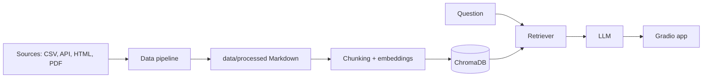

# RAG project: customer churn in European retail banking

A RAG system (LangChain + ChromaDB + multilingual-e5 + Gradio) on customer retention and churn in
French, German and Spanish retail banking. It turns the Kaggle *Bank Customer Churn* CSV into
computed text documents and combines them with public sources (papers, Wikipedia, ECB/Eurostat/World
Bank data, EU law, regulators) to show that RAG beats the same LLM without retrieval.

> **Status:** Stages 0 to 6 done (pipeline, index, evaluation, app on Cloud Run, advanced RAG, Quarto site).
> Progress and open items are in [PROGRESS.md](PROGRESS.md). Presentation guide for the team (Spanish): [documentacion/](documentacion/00_INDICE.md).
> The project is self-contained: it does not import from the churn-prediction project.

## Architecture



## Links
- App (Google Cloud Run): <https://rag-churn-6lkxbo5a5a-ew.a.run.app/>
- Quarto site (GitHub Pages): <https://adra642.github.io/Proyecto-IA/>
- Repository: <https://github.com/Adra642/Proyecto-IA> (folder `rag_project/`)

## Prerequisites
- Python 3.12 (pinned in `.python-version`; uv downloads it if missing), git
- [uv](https://docs.astral.sh/uv/)
  - Linux: `curl -LsSf https://astral.sh/uv/install.sh | sh`
  - Windows PowerShell: `powershell -ExecutionPolicy ByPass -c "irm https://astral.sh/uv/install.ps1 | iex"`
- Quarto (only for the docs, *Stage 6*)

## Setup

Linux (bash):
```bash
git clone git@github.com:Adra642/Proyecto-IA.git && cd Proyecto-IA/rag_project
uv sync                  # creates .venv and installs the locked dependencies
cp .env.example .env     # then fill in the keys
```

Windows (PowerShell):
```powershell
git clone git@github.com:Adra642/Proyecto-IA.git; cd Proyecto-IA\rag_project
uv sync
Copy-Item .env.example .env
```

Activating `.venv` is optional because `uv run` uses it (`source .venv/bin/activate` on Linux,
`.venv\Scripts\Activate.ps1` on Windows; if PowerShell blocks scripts, run
`Set-ExecutionPolicy -Scope CurrentUser RemoteSigned`). Fallback without uv:
`python -m venv .venv`, activate it, `pip install -e ".[dev]"`; never outside `.venv`.

## Configuration

Defaults are in `config.yaml`; environment variables and `.env` override them. Only the selected
LLM provider's key is needed.

| Variable | Purpose | Where to get it |
|---|---|---|
| `LLM_PROVIDER` | `gemini` (default), `groq` or `deepseek`; overrides `llm.provider` | n/a |
| `GOOGLE_API_KEY` | Gemini | <https://aistudio.google.com/apikey> |
| `GROQ_API_KEY` | Groq | <https://console.groq.com/keys> |
| `DEEPSEEK_API_KEY` | DeepSeek (pay-as-you-go) | <https://platform.deepseek.com> |
| `KAGGLE_USERNAME`, `KAGGLE_KEY` | Kaggle dataset download, only if anonymous access fails | Kaggle account settings, API token |

`llm.fallback_order` (e.g. `[gemini, groq, deepseek]`) makes the app try the next provider when
the active one is rate-limited. Nested values can be overridden with `__`, e.g.
`LLM__MODELS__GROQ=...`. Other `config.yaml` options (sources, chunk size, k) arrive in later stages.

## Run the data pipeline

```bash
uv run python -m data_pipeline.run_all                 # all enabled sources
uv run python -m data_pipeline.run_all --sources a1,a3 # only some sources (a2 is an alias of a1)
uv run python -m data_pipeline.run_all --refresh       # bypass the raw download cache
```

Per source: fetch (polite, cached, retried) -> clean (HTML to Markdown, unicode/whitespace
normalization, de-duplication, tiny documents dropped) -> write. A failing source or page is
logged and reported but never stops the others.

| Output | What |
|---|---|
| `data/processed/<source>/<doc_id>.md` | one Markdown document per item, YAML front matter = the Section 5.3 metadata |
| `data/processed/stats.json` | every number used in the derived churn documents, keyed by dotted name |
| `data/SOURCES.md` | generated table: source, formats, languages, retrieval date, license |
| `logs/run_report.json`, `logs/pipeline.log` | documents/words per source, failures, PII check (git-ignored) |
| `data/raw/` | cache of raw downloads (git-ignored); delete it or use `--refresh` to re-download |

Idempotence: `retrieved_at` comes from the cache manifest and files are written in a stable order,
so running the pipeline twice with the same cache gives byte-identical `data/processed/`.
`--refresh` intentionally updates live data (ECB rates, Eurostat, ...).

Sources (`config.yaml` -> `sources`): A1/A2 Kaggle churn CSV and derived analytics, A3 arXiv,
A4 Wikipedia, A5 ECB Data Portal, A6 EU law (EUR-Lex with Cellar fallback), B1 Banco de España,
B2 Eurostat, B3 World Bank, B4 ECB press releases (RSS), B5 ECB HFCS, B6 EBA consumer pages, B7 credit registers (CIRBE, SCHUFA, FICP), B8 Banque de
France / BaFin / Bundesbank. Each has an `enabled` flag and its own options (queries, pages, series).

Privacy: `RowNumber`, `CustomerId` and `Surname` are dropped before any document is created.
After every run a scoped check scans `data/processed/` (no CustomerId anywhere, no surname in
documents derived from the dataset; surnames in external text are logged as collisions).

## Build the index

```bash
uv run python -m rag.index --rebuild                       # drop the collection and index everything
uv run python -m rag.index                                 # incremental: only new or changed documents
uv run python -m rag.index --query "churn rate in Germany" -k 5   # try a retrieval
```

The first build downloads `intfloat/multilingual-e5-small` (about 470 MB) and embeds about 6,300
chunks on CPU (about 5 minutes). The index is a persistent Chroma collection in `chroma_db/`
(git-ignored). Each chunk carries the full document metadata (source, type, language, geography,
topic, dataset columns, license, header path) so it can be filtered; a fingerprint of text,
metadata, chunking settings and embedding model makes re-runs incremental and idempotent.

**Chunking** (`config.yaml` -> `chunking`, code in `rag/chunking.py`), chosen per document type:

| Document type | Strategy |
|---|---|
| segment cards, data dictionary, ECB / Eurostat / World Bank notes (`dataset_stats`, `macro_data`) | not split: one document = one chunk, so a number is never separated from its label |
| Wikipedia, EU law, regulator pages, papers, press | split on Markdown headers (the header path is kept as metadata), then recursively by paragraph, line, sentence and word with an overlap |

Each chunk is embedded together with the document title and its header path, so a clause of a law
or a section of a guide keeps its context.

### Chunk-size experiment

```bash
uv run python -m eval.chunking_experiment --with-fixed   # about 20 min on CPU: re-embeds the corpus per size
```

Writes `eval/chunking_results.csv`, `eval/chunking_detail.csv` (per question) and
`eval/chunking_results.png`. Retrieval only, 13 questions with gold sources (`eval/questions.json`),
scored at chunk level (hit@k, MRR):

| Variant | Chunks | Avg chars | hit@1 | hit@3 | hit@5 | MRR | Context (top 5, chars) |
|---|---|---|---|---|---|---|---|
| 300 / 45 overlap | 9,743 | 217 | 0.85 | 0.92 | 1.00 | 0.887 | 1,933 |
| **600 / 90 overlap** | 4,663 | 453 | 0.85 | 0.92 | 1.00 | 0.887 | 2,605 |
| 1000 / 150 overlap | 2,942 | 725 | 0.85 | 0.92 | 1.00 | 0.887 | 3,369 |

Reading: on the final corpus and 13 retrieval questions the three sizes **tie on every metric** (one
question is 0.077), so the experiment no longer separates them; the earlier, smaller corpus did put
300 characters behind. The choice of **600 / 90** stays a trade-off: half the chunks of 300 (less to
embed and store) and about 23 % less context for the LLM than 1000. The documents that are never split
(dataset cards, macro notes) do not depend on the size. (Measured earlier, header-aware and fixed-size
chunking also tied.)

## Run the evaluation

Fifteen questions (`eval/questions.json`) are answered in two modes with the **same LLM**
(`config.yaml` -> `llm`): **No RAG** (the plain model, told to say so when it does not know) and
**RAG** (top-4 chunks from the index, answer only from the context, cite `[doc_id]`).

```bash
uv run python -m eval.generate_gold   # fills gold numbers/answers from stats.json and the ingested texts
uv run python -m eval.run_eval        # answers every question in both modes -> eval/results.csv/.json
uv run python -m eval.score           # automatic scores -> eval/auto_scores.csv, eval/auto_summary.csv
uv run python -m eval.score --examples --example-ids D1,R3   # before/after examples for the memoir
```

- Questions: 4 about the dataset (D), 2 from the literature (L), 7 regulatory, current or from the
  regulator and survey sources added late (R: the 2012 Commission switching study, Eurostat, ECB rate, Banco de España
  complaints 2025, CCSF switching review, World Bank branches, EBA Consumer Trends Report) and 2
  behavioural (U: an answer that is not in the corpus, and a request for a surname that must be
  refused). No gold number is typed by hand: dataset values come from `stats.json`, regulatory and
  ECB/Eurostat values are read from the ingested texts with regexes stored in the question file.
- There is no answer cache: every run calls the LLM again and overwrites `eval/results.json`, so small
  differences between runs are expected (see the `temperature` note below). Client-side throttling and retry
  with backoff handle rate limits.
- Scoring is **automatic only** (hit@k, numeric match against the generated gold, citation check,
  abstention and PII-leak checks); there is no manual scoring step, so differences are read as
  indicative (15 questions, one run).
- `eval/literature_verification.md` lists the PDF sentences behind the two literature gold answers
  (drafted from abstracts); a human verified them against the PDF on 2026-11-26.

Automatic results (`eval/auto_summary.csv`, Gemini `gemini-3.5-flash-lite`, one run):

| Category | Mode | Numeric match | hit@4 | Citation OK | Behaviour OK |
|---|---|---|---|---|---|
| D dataset (4) | No RAG | 0.12 | | | |
| D dataset (4) | RAG | 0.75 | 0.75 | 0.75 | |
| D dataset (4) | RAG avanzado | 1.00 | 1.00 | 0.75 | |
| L literature (2) | RAG | n/a | 1.00 | 1.00 | |
| L literature (2) | RAG avanzado | n/a | 1.00 | 1.00 | |
| R regulatory, current, regulators (7) | No RAG | 0.00 | | | |
| R regulatory, current, regulators (7) | RAG | 0.83 | 1.00 | 0.86 | |
| R regulatory, current, regulators (7) | RAG avanzado | 0.83 | 1.00 | 1.00 | |
| U behavioural (2) | No RAG / RAG / RAG avanzado | | | | 1.00 |

How to read it: *numeric match* is the share of the gold figures that appear in the answer, *hit@4* whether
a gold document is among the 4 retrieved chunks, *citation OK* whether the answer cites a document that was
retrieved, *behaviour OK* whether the model declined the two unanswerable questions. RAG answers the dataset,
regulator and survey questions with exact, cited figures, while the plain model scores 0.00 on both groups:
the new-source questions (Banco de España complaints, CCSF "did not dare" share, World Bank branches) are
facts it cannot know, and on R7 it says it does not know. Failures are kept on purpose as diagnostics:
**D6** (the plain question "churn rate in Germany": the phrase "Kaggle Bank Customer Churn dataset" matches
every card; plain RAG misses, hybrid search fixes it) and **R1** (the 2012 Commission switching study: the right document is retrieved, but the report is hundreds of pages with dozens of similar percentages and the chunk holding the figure is not in the top 4; both RAG modes still miss it). Scores come from a single run per question and
Gemini 3.5 ignores `temperature`, so small differences (for example a citation) can change between runs.
A router bug found while adding the new sources is fixed: the word "study" used to trigger the arXiv-paper
filter, which hid the Bundesbank study; only "arXiv", "paper", "authors" and "transformer" do now.

## Run the app
```bash
uv run python -m app.app          # or: uv run poe app   -> http://localhost:8080 (set PORT to change)
```
It needs `GOOGLE_API_KEY` for the default model; the **model selector** at the top of the page switches
between Gemini (default), Groq and DeepSeek, and shows a clear message when the chosen provider's key is not set. On start it syncs the Chroma
index with `data/processed/` (a no-op when current; a cold build takes about 5 minutes on CPU).
The interface and every answer are in Spanish (the prompts ask for Spanish whatever the question's language): a **Chat** tab (mode *Sin RAG* / *RAG*, response time, a *Fuentes*
accordion with title, link, source, similarity and the retrieved text), a **Comparar** tab (same
question, No RAG | RAG side by side), example buttons (the evaluation questions) and an **Acerca de**
tab. Rate-limited calls are retried once, then a friendly message is shown. **RAG avanzado**
(hybrid search, routing and metadata filters) has its own mode and filter controls (source type,
geography, language); the **Comparar** tab shows all three modes side by side, with the sources of RAG and
RAG avanzado next to each other. Sources use a smaller font and link to the original document.
The Quarto site has a light/dark switch; the "App y despliegue" page covers the app deploy and the docs workflow.

## Advanced RAG (Stage 5)
Mode *RAG avanzado* (`RagChain.answer_advanced`) = **router** -> **hybrid retrieval** (BM25 + vector)
-> optional **reranking** -> same prompt and LLM as plain RAG:
- `rag/lexical.py`: BM25 (`rank_bm25`) over title + header path + text; `matches_where` applies the same
  Chroma-style filters to the lexical side.
- `rag/retrievers.py`: `HybridRetriever` fuses the two rankings with weighted reciprocal-rank fusion
  (0.5/0.5, `rrf_k` 60, 20 candidates from each); `RerankingRetriever` decorates any retriever with a
  `Reranker` (`rag/rerank.py`, FlashRank, local ONNX, no key).
- `rag/router.py`: deterministic rules decide *retrieve or answer directly* (small talk) and a filter
  (`source_type`, plus `geography in [country, EU]` when the question names one country). The filter is a
  hint: when it finds nothing the search is repeated without it. Filters picked in the UI override the router.
- Reranking is **on** (`retrieval.rerank_enabled: true`) and **blended**: `BlendedReranker` mixes the order of
  the FlashRank cross-encoder (TinyBERT, weight 0.7) with the hybrid order using reciprocal ranks. The
  cross-encoder alone hurt a hybrid ranking that was already strong (see the table); the blend keeps its gains
  and avoids its losses. `rerank_weight` and `rerank_with_title` are in `config.yaml`; the Docker image
  downloads the FlashRank model at build time.

```bash
uv run python -m eval.ablation     # retrieval-only ablation -> eval/ablation.csv, ablation_detail.csv
uv run python -m eval.rerank_sweep # pool size x blend weight x title -> eval/rerank_sweep.csv
uv run python -m eval.run_eval     # now also runs rag_advanced (cached answers)
```

Retrieval ablation (13 questions with gold sources; hit@k and MRR are per document, hit@4 = what the LLM sees;
fact@k and fact MRR are per chunk, over the 10 questions with a gold figure: a chunk counts only if it belongs
to a gold document **and** contains the figure):

| Configuration | hit@1 | hit@4 | MRR | fact@1 | fact@4 | fact MRR |
|---|---|---|---|---|---|---|
| vector (baseline) | 0.846 | 0.923 | 0.887 | 0.70 | 0.90 | 0.778 |
| + hybrid (BM25 + vector) | **1.000** | 1.000 | **1.000** | 0.90 | 0.90 | 0.900 |
| + rerank (TinyBERT, alone) | 0.923 | 1.000 | 0.962 | 0.80 | 1.00 | 0.883 |
| + rerank blend (TinyBERT, 0.7) | **1.000** | 1.000 | **1.000** | 0.90 | **1.00** | **0.933** |
| + filters (router, hybrid) | 1.000 | 1.000 | 1.000 | 0.90 | 0.90 | 0.900 |
| + filters + rerank (TinyBERT, alone) | 0.923 | 1.000 | 0.962 | 0.80 | 1.00 | 0.883 |
| + filters + rerank blend (TinyBERT, 0.7) | 1.000 | 1.000 | 1.000 | 0.90 | 1.00 | 0.933 |
| rerank MiniLM-L-12 (+filters) | 0.769 | 1.000 | 0.865 | 0.60 | 1.00 | 0.775 |
| rerank MultiBERT-L-12 (+filters) | 0.462 | 0.692 | 0.545 | 0.20 | 0.50 | 0.308 |

Hybrid search is the technique that pays off: it lifts hit@1 from 0.846 to 1.000, and the plain "churn rate in
Germany" question (**D6**) goes from a wrong answer to a right one (numeric match 0 to 1 in
`eval/auto_summary.csv`). At document level hybrid is already perfect, so a reranker has nothing to gain; at chunk
level it does: hybrid misses the chunk with the figure for **R1** (fact@4 0.90) and any reranker brings it to
rank 3. The cross-encoder alone costs precision (D6 drops from rank 1 to 2, hit@1 0.923) and the larger rerankers
hurt more (web-passage training; the multilingual one is far worse). The **blend** keeps the R1 gain and the
rank-1 results. `eval/rerank_sweep.csv` (27 variants: pool 10/20/30, weight 1.0/0.7/0.5/0.3, title shown or
not) shows weights 0.5 to 0.7 with the title give the same result at every pool size, so 0.7 with 20 candidates
is not a knife-edge choice; without the title or with weight 0.3 the gain is less stable. Caveats: 13 questions
(10 with a figure), one question is 0.077 to 0.1, and the blend was chosen on the same questions.
Answer level (`eval/auto_summary.csv`, one run per question): numeric match D 0.12 / 0.75 / 1.00 and R
0.00 / 0.83 / 0.83 for No RAG / RAG / RAG avanzado. R1 still fails in both RAG modes: its figure now reaches the
model (rank 3), but the sentence is about banks that did not complete the account opening, and the model
answers "no lo sé".

## Tests and quality
```bash
uv run pytest                    # unit tests, offline (coverage report included)
uv run pytest -m integration     # real LLM / embedding calls and live fetches; needs keys, downloads the e5 model
uv run ruff check .             # lint
uv run ruff format --check .    # formatting (no changes written)
uv run mypy                     # static types
uv run pre-commit install        # run from the git root with -c rag_project/.pre-commit-config.yaml
```
The hooks live in `.pre-commit-config.yaml` (ruff only; mypy runs through `poe typecheck`).
From the repo root: `uv run --project rag_project pre-commit install -c rag_project/.pre-commit-config.yaml`.

## Task shortcuts (identical on Linux and Windows)
`uv run poe pipeline | index | eval | app | test | test-integration | lint | typecheck`; `docs` arrives in Stage 6.

## Deployment (Google Cloud Run)
The app is deployed as a container on **Cloud Run**.

```bash
podman build -f deploy/Dockerfile -t rag-churn .      # or docker build; run from rag_project/
podman run --rm -p 8080:8080 -e GOOGLE_API_KEY=... rag-churn
```
The image bakes in the e5 model and the Chroma index (Cloud Run's disk is ephemeral), so a cold
start only loads them. **No local `gcloud` is needed**: use Cloud Shell (<https://shell.cloud.google.com>)
or the Cloud Console.

1. In the Console: enable Cloud Run, Cloud Build, Artifact Registry and Secret Manager.
2. Secret Manager: create `google-api-key` with your Gemini key. Give the Cloud Run service account
   the *Secret Manager Secret Accessor* role.
3. Cloud Run, *Create service*, *Continuously deploy from a repository*: connect the GitHub repo,
   build type **Dockerfile** `rag_project/deploy/Dockerfile`, source directory `rag_project`
   (or use `deploy/cloudbuild.yaml`: 30-minute timeout and a layer cache from the previous image).
4. Settings: region `europe-west1`, **2 GiB memory, 2 CPU**, min instances 0 (1 for the live demo),
   max instances 2, allow unauthenticated invocations, and the secret as env var `GOOGLE_API_KEY`.
5. Create a **budget alert** (Billing, Budgets & alerts) before the first deployment.

Cloud Shell, building with the config file (the route used for the live deployment):
```bash
# Cloud Build builds the image, pushes it and deploys it to Cloud Run (run from the git root)
gcloud builds submit rag_project --config rag_project/deploy/cloudbuild.yaml \
  --substitutions=SHORT_SHA=v2,_CONTEXT=. --timeout=30m
```
Uploading only `rag_project/` keeps the other project's files out of the build. `SHORT_SHA` is only set
automatically by triggers, so change it for every manual build.

**Image size and build time.** The Dockerfile installs only the runtime dependencies (`uv sync
--no-default-groups`: the data-pipeline packages live in the `pipeline` group, which `uv sync` still
installs locally) with `--no-cache` (uv's wheel cache was 1.7 GB of the old image), and orders its layers
as dependencies, then model and index, then the app. `cloudbuild.yaml` pulls the previous `:latest`
and builds with `--cache-from`, so a build after a UI-only change reuses the dependency and index layers.
A first build, or one after a `uv.lock` change, still takes about 10 minutes (the index embeds the
corpus: about 200 s on CPU). Measured sizes and times are in `PROGRESS.md` (Stage 5).

## Quarto documentation site
The memoir lives in `docs/` (Spanish): home, data and sources, pipeline, chunking and vector DB, evaluation,
advanced RAG, app and deployment, team and references. Tables and plots are Python cells that read the saved
results in `eval/` and `data/`, and the code excerpts are cut from the source files, so the site shows what
was measured and what is in the repository.

```bash
uv sync --group docs               # adds jupyter and matplotlib (docs group)
uv run quarto preview docs         # live preview (needs Quarto >= 1.4: https://quarto.org/docs/get-started/)
uv run quarto render docs          # or: uv run poe docs   -> docs/_site/
```

**Publishing (GitHub Pages, team decision):** `.github/workflows/rag_project-docs.yml` (repo root, filtered to
`rag_project/**`) renders the site on every push to `main` and deploys it; on pull requests it only checks that
the site renders. One-time setup: *Settings, Pages, Source = GitHub Actions*. The workflow needs no secrets.
`docs/_freeze/` is git-ignored on purpose: CI always re-executes the cells against the committed results.
Cloudflare Pages is also possible (root directory `rag_project/docs`, build command `quarto render`, output
`_site`) but is not set up.


## Project structure
```
rag_project/
├── config.yaml, pyproject.toml, uv.lock, .python-version, .env.example
├── core/            settings (pydantic-settings), logging, exceptions, domain models, corpus loader
├── rag/             llm.py (adapters, fallback, throttle/retry), embeddings.py, chunking.py,
│                    vectorstore.py (Chroma repository), index.py (CLI), retrievers.py, prompts.py,
│                    chain.py (No-RAG, RAG and advanced modes, privacy guard),
│                    lexical.py (BM25, filters), rerank.py (FlashRank), router.py (rules)
├── factory.py       composition root: wires components from settings
├── data_pipeline/
│   ├── fetchers/    one module per source + base.py (template, registry)
│   ├── http.py, cache.py, resilience.py   polite client, raw cache, retry/rate limit
│   ├── clean.py, build_docs.py            cleaning steps; pandas -> churn documents + stats
│   ├── writer.py, pii_check.py            output files, SOURCES.md; privacy scan
│   └── run_all.py   orchestrator + run report
├── eval/            questions.json (+ gold), generate_gold.py, run_eval.py, score.py,
│                    retrieval_metrics.py, chunking_experiment.py; results, scores and examples
├── app/             Gradio app (3 modes, filters): handlers.py (logic, errors, sources), ui.py (Blocks), app.py (entry)
├── deploy/          Dockerfile (Cloud Run image), cloudbuild.yaml
├── docs/            Quarto site (_quarto.yml, 8 .qmd pages, _helpers.py, img/)
├── data/            raw/ (git-ignored cache), processed/ (committed documents)
└── tests/           unit/ (offline), integration/ (marked), fixtures/
```
`core/` is a small shared package so `data_pipeline` and `rag` never import each other.

Design patterns in use so far:
- Adapter + Factory: `LLMClient` / `build_llm`, `Embedder` / `build_embedder`.
- Decorator: `FallbackLLM`; retry with backoff and per-host rate limiting (`resilience.py`).
- Template Method + Registry: `BaseFetcher.fetch()` implements cache, error isolation and logging
  once; subclasses implement `_items`, `_download`, `_parse`; `@register_fetcher("a4")` registers them.
- Chain of fallbacks: EUR-Lex HTML, then Cellar XHTML, then Cellar PDF.
- Pipeline of small pure functions: the cleaning steps and the statistics in `build_docs.py`.
- Strategy: `Chunker` (passthrough, markdown+recursive, fixed-size) behind `build_chunker`, with a
  routing chunker that picks the strategy by document type.
- Repository: `VectorStoreRepository` wraps Chroma (`add / query / delete / rebuild`); nothing else imports chromadb.
- Decorator also wraps the LLM clients: `ThrottledLLM` (min interval) and `RetryingLLM` (backoff on 429).
- Strategy + Decorator for retrieval: `Retriever` (vector, BM25, hybrid) and `RerankingRetriever` wrapping any of them; `Reranker` strategy.
- Dependency injection with a composition root (`factory.py`); typed settings and domain models.

## Troubleshooting
- *Missing API key:* the error names the variable; set it in `.env` or the environment.
- *Rate limits:* set `llm.fallback_order` or switch `LLM_PROVIDER`.
- *Model not found (404):* provider models get retired; list what your key can use and update `llm.models` in `config.yaml` (Gemini 2.5 models are retired; the default is `gemini-3.5-flash-lite`).
- *Gemini ignores `temperature`:* the 3.5 models use fixed sampling, so answers can vary slightly between runs; the evaluation does not try to hide that (one run per question, no cache).
- *HTTP 429 during the evaluation:* the client waits and retries (10 s, 20 s, 40 s); raise `llm.min_interval_seconds` if it keeps happening.
- *Kaggle:* the public dataset downloads anonymously with `kagglehub`. If it ever needs auth, set
  `KAGGLE_USERNAME` / `KAGGLE_KEY`, or put a raw CSV URL in `sources.a1.fallback_url`.
- *EUR-Lex blocking:* EUR-Lex answers bots with an empty challenge page; the fetcher detects it
  and falls back to the Publications Office (Cellar) XHTML, then PDF. Failures show in the run report.
- *HTTP 429 / slow first run:* Wikimedia and arXiv rate-limit; the client retries with backoff.
  arXiv honours its 15 s crawl delay, so the first run takes several minutes; later runs use the cache.
- *A source is empty in the report:* see `logs/pipeline.log` and the `errors` of that source in
  `logs/run_report.json`; re-run it alone with `--sources`.
- *Empty index / "No documents" error:* run the pipeline first, then `uv run python -m rag.index --rebuild`.
- *Slow first index:* the e5 model downloads once and embedding runs on CPU; later runs are incremental.
- Space cold start: *added with Stage 4.*

## Data attribution and licenses
Sources and licenses are listed in `data/SOURCES.md` (generated by the pipeline, *Stage 1*).

## Team
*To be filled in.*
