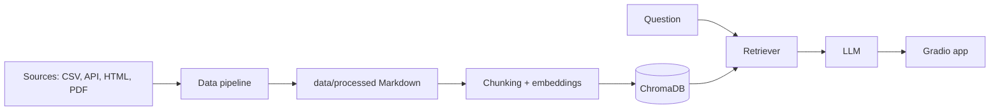

# RAG project: customer churn in European retail banking

A RAG system (LangChain + ChromaDB + multilingual-e5 + Gradio) on customer retention and churn in
French, German and Spanish retail banking. It turns the Kaggle *Bank Customer Churn* CSV into
computed text documents and combines them with public sources (papers, Wikipedia, ECB/Eurostat/World
Bank data, EU law, regulators) to show that RAG beats the same LLM without retrieval.

> **Status:** Stages 0 (scaffold), 1 (data pipeline), 2 (chunking, index) and 3 (evaluation) done.
> Later stages (app, advanced RAG, docs) are tracked in [PROGRESS.md](PROGRESS.md); sections below marked *Stage n* are filled in then.
> The project is self-contained: it does not import from the churn-prediction project.

## Architecture



## Links
- App: *Stage 4*
- Quarto site: *Stage 6*
- Repository: <https://github.com/Adra642/Proyecto-IA> (folder `rag_project/`)

## Prerequisites
- Python 3.12 (pinned in `.python-version`; uv downloads it if missing), git
- [uv](https://docs.astral.sh/uv/)
  - Linux: `curl -LsSf https://astral.sh/uv/install.sh | sh`
  - Windows PowerShell: `powershell -ExecutionPolicy ByPass -c "irm https://astral.sh/uv/install.ps1 | iex"`
- Quarto (only for the docs, *Stage 6*)

## Setup

Linux (bash):
```bash
git clone git@github.com:Adra642/Proyecto-IA.git && cd Proyecto-IA/rag_project
uv sync                  # creates .venv and installs the locked dependencies
cp .env.example .env     # then fill in the keys
```

Windows (PowerShell):
```powershell
git clone git@github.com:Adra642/Proyecto-IA.git; cd Proyecto-IA\rag_project
uv sync
Copy-Item .env.example .env
```

Activating `.venv` is optional because `uv run` uses it (`source .venv/bin/activate` on Linux,
`.venv\Scripts\Activate.ps1` on Windows; if PowerShell blocks scripts, run
`Set-ExecutionPolicy -Scope CurrentUser RemoteSigned`). Fallback without uv:
`python -m venv .venv`, activate it, `pip install -e ".[dev]"`; never outside `.venv`.

## Configuration

Defaults are in `config.yaml`; environment variables and `.env` override them. Only the selected
LLM provider's key is needed.

| Variable | Purpose | Where to get it |
|---|---|---|
| `LLM_PROVIDER` | `gemini` (default), `groq` or `deepseek`; overrides `llm.provider` | n/a |
| `GOOGLE_API_KEY` | Gemini | <https://aistudio.google.com/apikey> |
| `GROQ_API_KEY` | Groq | <https://console.groq.com/keys> |
| `DEEPSEEK_API_KEY` | DeepSeek (pay-as-you-go) | <https://platform.deepseek.com> |
| `KAGGLE_USERNAME`, `KAGGLE_KEY` | Kaggle dataset download, only if anonymous access fails | Kaggle account settings, API token |
| `HF_TOKEN` | optional: higher Hugging Face Hub rate limits when downloading the e5 model | <https://huggingface.co/settings/tokens> |

`llm.fallback_order` (e.g. `[gemini, groq, deepseek]`) makes the app try the next provider when
the active one is rate-limited. Nested values can be overridden with `__`, e.g.
`LLM__MODELS__GROQ=...`. Other `config.yaml` options (sources, chunk size, k) arrive in later stages.

## Run the data pipeline

```bash
uv run python -m data_pipeline.run_all                 # all enabled sources
uv run python -m data_pipeline.run_all --sources a1,a3 # only some sources (a2 is an alias of a1)
uv run python -m data_pipeline.run_all --refresh       # bypass the raw download cache
```

Per source: fetch (polite, cached, retried) -> clean (HTML to Markdown, unicode/whitespace
normalization, de-duplication, tiny documents dropped) -> write. A failing source or page is
logged and reported but never stops the others.

| Output | What |
|---|---|
| `data/processed/<source>/<doc_id>.md` | one Markdown document per item, YAML front matter = the Section 5.3 metadata |
| `data/processed/stats.json` | every number used in the derived churn documents, keyed by dotted name |
| `data/SOURCES.md` | generated table: source, formats, languages, retrieval date, license |
| `logs/run_report.json`, `logs/pipeline.log` | documents/words per source, failures, PII check (git-ignored) |
| `data/raw/` | cache of raw downloads (git-ignored); delete it or use `--refresh` to re-download |

Idempotence: `retrieved_at` comes from the cache manifest and files are written in a stable order,
so running the pipeline twice with the same cache gives byte-identical `data/processed/`.
`--refresh` intentionally updates live data (ECB rates, Eurostat, ...).

Sources (`config.yaml` -> `sources`): A1/A2 Kaggle churn CSV and derived analytics, A3 arXiv,
A4 Wikipedia, A5 ECB Data Portal, A6 EU law (EUR-Lex with Cellar fallback), B1 Banco de España,
B2 Eurostat, B3 World Bank, B4 ECB press releases (RSS), B5 ECB HFCS, B6 EBA consumer pages, B7 credit registers (CIRBE, SCHUFA, FICP), B8 Banque de
France / BaFin / Bundesbank. Each has an `enabled` flag and its own options (queries, pages, series).

Privacy: `RowNumber`, `CustomerId` and `Surname` are dropped before any document is created.
After every run a scoped check scans `data/processed/` (no CustomerId anywhere, no surname in
documents derived from the dataset; surnames in external text are logged as collisions).

## Build the index

```bash
uv run python -m rag.index --rebuild                       # drop the collection and index everything
uv run python -m rag.index                                 # incremental: only new or changed documents
uv run python -m rag.index --query "churn rate in Germany" -k 5   # try a retrieval
```

The first build downloads `intfloat/multilingual-e5-small` (about 470 MB) and embeds about 6,300
chunks on CPU (about 5 minutes). The index is a persistent Chroma collection in `chroma_db/`
(git-ignored). Each chunk carries the full document metadata (source, type, language, geography,
topic, dataset columns, license, header path) so it can be filtered; a fingerprint of text,
metadata, chunking settings and embedding model makes re-runs incremental and idempotent.

**Chunking** (`config.yaml` -> `chunking`, code in `rag/chunking.py`), chosen per document type:

| Document type | Strategy |
|---|---|
| segment cards, data dictionary, ECB / Eurostat / World Bank notes (`dataset_stats`, `macro_data`) | not split: one document = one chunk, so a number is never separated from its label |
| Wikipedia, EU law, regulator pages, papers, press | split on Markdown headers (the header path is kept as metadata), then recursively by paragraph, line, sentence and word with an overlap |

Each chunk is embedded together with the document title and its header path, so a clause of a law
or a section of a guide keeps its context.

### Chunk-size experiment

```bash
uv run python -m eval.chunking_experiment --with-fixed   # about 20 min on CPU: re-embeds the corpus per size
```

Writes `eval/chunking_results.csv`, `eval/chunking_detail.csv` (per question) and
`eval/chunking_results.png`. Retrieval only, 10 questions with gold sources (`eval/questions.json`),
scored at chunk level (hit@k, MRR):

| Variant | Chunks | Avg chars | hit@1 | hit@3 | hit@5 | MRR | Context (top 5, chars) |
|---|---|---|---|---|---|---|---|
| 300 / 45 overlap | 13,466 | 197 | 0.80 | 1.00 | 1.00 | 0.883 | 2,154 |
| **600 / 90 overlap** | 6,309 | 415 | 0.90 | 1.00 | 1.00 | 0.933 | 2,795 |
| 1000 / 150 overlap | 3,873 | 681 | 0.90 | 1.00 | 1.00 | 0.933 | 3,341 |
| fixed 600 (no headers) | 6,000 | 438 | 0.90 | 1.00 | 1.00 | 0.933 | 2,735 |

Reading: 300 characters is worse (one more question misses rank 1) and doubles the number of
chunks; 600 and 1000 tie. 600 gives the same retrieval quality with about 16 % less context
passed to the LLM. With 10 questions one question is 0.1, and the documents that are never split
(dataset cards, macro notes) are unaffected by the size, so the experiment separates sizes only
weakly. The header-aware and size-only strategies tie on this question set.

## Run the evaluation

Fourteen questions (`eval/questions.json`) are answered in two modes with the **same LLM**
(`config.yaml` -> `llm`): **No RAG** (the plain model, told to say so when it does not know) and
**RAG** (top-4 chunks from the index, answer only from the context, cite `[doc_id]`).

```bash
uv run python -m eval.generate_gold   # fills gold numbers/answers from stats.json and the ingested texts
uv run python -m eval.run_eval        # answers every question in both modes -> eval/results.csv/.json
uv run python -m eval.score           # automatic scores + eval/manual_scoring.csv for the team
uv run python -m eval.score --summary # after scoring by hand: mean score per category and mode
uv run python -m eval.score --examples --example-ids D1,R3   # before/after examples for the memoir
```

- Questions: 6 about the dataset (D), 2 from the literature (L), 4 regulatory or current (R) and 2
  behavioural (U: an answer that is not in the corpus, and a request for a surname that must be
  refused). No gold number is typed by hand: dataset values come from `stats.json`, regulatory and
  ECB/Eurostat values are read from the ingested texts with regexes stored in the question file.
- Answers are cached in `eval/cache/` (key: provider and model, prompts version, chunking and
  embedding settings, hash of the indexed corpus, question), so a re-run is free and reproducible;
  `--refresh` ignores the cache. Client-side throttling and retry with backoff handle rate limits.
- Manual scoring (`score_0_1_2` in `eval/manual_scoring.csv`): 0 = wrong or hallucinated, 1 = partly
  right or vague, 2 = correct and specific; plus `citation_correct_Y_N` for RAG. Re-exporting keeps
  what you already filled in.
- `eval/literature_verification.md` lists the PDF sentences behind the two literature gold answers
  (drafted from abstracts): a human must tick them.

Automatic results (`eval/auto_summary.csv`, Gemini `gemini-3.5-flash-lite`, one cached run):

| Category | Mode | Numeric match | hit@4 | Citation OK | Behaviour OK |
|---|---|---|---|---|---|
| D dataset (6) | No RAG | 0.00 | | | |
| D dataset (6) | RAG | 0.83 | 0.83 | 0.83 | |
| L literature (2) | No RAG | n/a | | | |
| L literature (2) | RAG | n/a | 1.00 | 1.00 | |
| R regulatory/current (4) | No RAG | 0.25 | | | |
| R regulatory/current (4) | RAG | 0.75 | 1.00 | 0.50 | |
| U behavioural (2) | No RAG | | | | 1.00 |
| U behavioural (2) | RAG | | | | 1.00 |

How to read it: RAG answers the dataset, literature and current-data questions with exact, cited
figures; the plain model says "I do not know" (its prompt allows it, so it does not hallucinate
numbers, and the behavioural questions do not separate the two modes). Failures are kept on purpose
as diagnostics for the advanced techniques: **D6** (the plain question "churn rate in Germany":
the phrase "Kaggle Bank Customer Churn dataset" matches every card, so the Germany card ranks 4th),
**R1** (the answer sits in the chunk after the one retrieved) and **R4** (the model already knows
the caps; RAG answered from Wikipedia instead of the regulation). Scores come from a single run per
question and Gemini 3.5 ignores `temperature`, so small differences (for example a citation) can
change between runs.

## Run the app
```bash
uv run python -m app.app          # or: uv run poe app   -> http://localhost:8080 (set PORT to change)
```
It needs `GOOGLE_API_KEY` (or the key of the provider chosen in `.env`). On start it syncs the Chroma
index with `data/processed/` (a no-op when current; a cold build takes about 5 minutes on CPU).
The interface is in Spanish: a **Chat** tab (mode *Sin RAG* / *RAG*, response time, a *Fuentes*
accordion with title, link, source, similarity and the retrieved text), a **Comparar** tab (same
question, No RAG | RAG side by side), example buttons (the evaluation questions) and an **Acerca de**
tab. Rate-limited calls are retried once, then a friendly message is shown. *RAG avanzado* and the
metadata filters arrive in Stage 5.

## Tests and quality
```bash
uv run pytest                    # unit tests, offline (coverage report included)
uv run pytest -m integration     # real LLM / embedding calls and live fetches; needs keys, downloads the e5 model
uv run ruff check .
uv run ruff format --check .
uv run mypy
uv run pre-commit install        # run from the git root with -c rag_project/.pre-commit-config.yaml
```
The hooks live in `.pre-commit-config.yaml` (ruff only; mypy runs through `poe typecheck`).
From the repo root: `uv run --project rag_project pre-commit install -c rag_project/.pre-commit-config.yaml`.

## Task shortcuts (identical on Linux and Windows)
`uv run poe pipeline | index | eval | app | test | test-integration | lint | typecheck`; `docs` arrives in Stage 6.

## Deployment (Google Cloud Run)
Hugging Face Spaces was the original plan, but its docs now require a paid plan for Gradio and
Docker Spaces, so the app is deployed as a container on **Cloud Run** (decision of 2026-11-22).

```bash
podman build -f deploy/Dockerfile -t rag-churn .      # or docker build; run from rag_project/
podman run --rm -p 8080:8080 -e GOOGLE_API_KEY=... rag-churn
```
The image bakes in the e5 model and the Chroma index (Cloud Run's disk is ephemeral), so a cold
start only loads them. **No local `gcloud` is needed**: use Cloud Shell (<https://shell.cloud.google.com>)
or the Cloud Console.

1. In the Console: enable Cloud Run, Cloud Build, Artifact Registry and Secret Manager.
2. Secret Manager: create `google-api-key` with your Gemini key. Give the Cloud Run service account
   the *Secret Manager Secret Accessor* role.
3. Cloud Run, *Create service*, *Continuously deploy from a repository*: connect the GitHub repo,
   build type **Dockerfile** `rag_project/deploy/Dockerfile`, source directory `rag_project`
   (or use `deploy/cloudbuild.yaml`, which sets a 30-minute build timeout).
4. Settings: region `europe-west1`, **2 GiB memory, 2 CPU**, min instances 0 (1 for the live demo),
   max instances 2, allow unauthenticated invocations, and the secret as env var `GOOGLE_API_KEY`.
5. Create a **budget alert** (Billing, Budgets & alerts) before the first deployment.

Cloud Shell alternative: `gcloud run deploy rag-churn --source rag_project --dockerfile deploy/Dockerfile
--region europe-west1 --memory 2Gi --cpu 2 --allow-unauthenticated --set-secrets GOOGLE_API_KEY=google-api-key:latest`
(check `gcloud run deploy --help` for the flags your version accepts).

*Quarto docs: Stage 6.*

## Project structure
```
rag_project/
├── config.yaml, pyproject.toml, uv.lock, .python-version, .env.example
├── core/            settings (pydantic-settings), logging, exceptions, domain models, corpus loader
├── rag/             llm.py (adapters, fallback, throttle/retry), embeddings.py, chunking.py,
│                    vectorstore.py (Chroma repository), index.py (CLI), retrievers.py, prompts.py,
│                    chain.py (No-RAG and RAG modes, privacy guard)
├── factory.py       composition root: wires components from settings
├── data_pipeline/
│   ├── fetchers/    one module per source + base.py (template, registry)
│   ├── http.py, cache.py, resilience.py   polite client, raw cache, retry/rate limit
│   ├── clean.py, build_docs.py            cleaning steps; pandas -> churn documents + stats
│   ├── writer.py, pii_check.py            output files, SOURCES.md; privacy scan
│   └── run_all.py   orchestrator + run report
├── eval/            questions.json (+ gold), generate_gold.py, run_eval.py, score.py, answer cache,
│                    retrieval_metrics.py, chunking_experiment.py; results, scores and examples
├── app/             Gradio app: handlers.py (logic, errors, sources), ui.py (Blocks), app.py (entry)
├── deploy/          Dockerfile (Cloud Run image), cloudbuild.yaml
├── docs/            Stage 6
├── data/            raw/ (git-ignored cache), processed/ (committed documents)
└── tests/           unit/ (offline), integration/ (marked), fixtures/
```
`core/` is a small shared package so `data_pipeline` and `rag` never import each other.

Design patterns in use so far:
- Adapter + Factory: `LLMClient` / `build_llm`, `Embedder` / `build_embedder`.
- Decorator: `FallbackLLM`; retry with backoff and per-host rate limiting (`resilience.py`).
- Template Method + Registry: `BaseFetcher.fetch()` implements cache, error isolation and logging
  once; subclasses implement `_items`, `_download`, `_parse`; `@register_fetcher("a4")` registers them.
- Chain of fallbacks: EUR-Lex HTML, then Cellar XHTML, then Cellar PDF.
- Pipeline of small pure functions: the cleaning steps and the statistics in `build_docs.py`.
- Strategy: `Chunker` (passthrough, markdown+recursive, fixed-size) behind `build_chunker`, with a
  routing chunker that picks the strategy by document type.
- Repository: `VectorStoreRepository` wraps Chroma (`add / query / delete / rebuild`); nothing else imports chromadb.
- Decorator also wraps the LLM clients: `ThrottledLLM` (min interval) and `RetryingLLM` (backoff on 429).
- Dependency injection with a composition root (`factory.py`); typed settings and domain models.

## Troubleshooting
- *Missing API key:* the error names the variable; set it in `.env` or the environment.
- *Rate limits:* set `llm.fallback_order` or switch `LLM_PROVIDER`.
- *Model not found (404):* provider models get retired; list what your key can use and update `llm.models` in `config.yaml` (Gemini 2.5 models are retired; the default is `gemini-3.5-flash-lite`).
- *Gemini ignores `temperature`:* the 3.5 models use fixed sampling, so answers can vary between runs; the evaluation caches answers.
- *HTTP 429 during the evaluation:* the client waits and retries (10 s, 20 s, 40 s); raise `llm.min_interval_seconds` if it keeps happening.
- *Kaggle:* the public dataset downloads anonymously with `kagglehub`. If it ever needs auth, set
  `KAGGLE_USERNAME` / `KAGGLE_KEY`, or put a raw CSV URL in `sources.a1.fallback_url`.
- *EUR-Lex blocking:* EUR-Lex answers bots with an empty challenge page; the fetcher detects it
  and falls back to the Publications Office (Cellar) XHTML, then PDF. Failures show in the run report.
- *HTTP 429 / slow first run:* Wikimedia and arXiv rate-limit; the client retries with backoff.
  arXiv honours its 15 s crawl delay, so the first run takes several minutes; later runs use the cache.
- *A source is empty in the report:* see `logs/pipeline.log` and the `errors` of that source in
  `logs/run_report.json`; re-run it alone with `--sources`.
- *Empty index / "No documents" error:* run the pipeline first, then `uv run python -m rag.index --rebuild`.
- *Slow first index:* the e5 model downloads once and embedding runs on CPU; later runs are incremental.
- Space cold start: *added with Stage 4.*

## Data attribution and licenses
Sources and licenses are listed in `data/SOURCES.md` (generated by the pipeline, *Stage 1*).

## Team
*To be filled in.*
