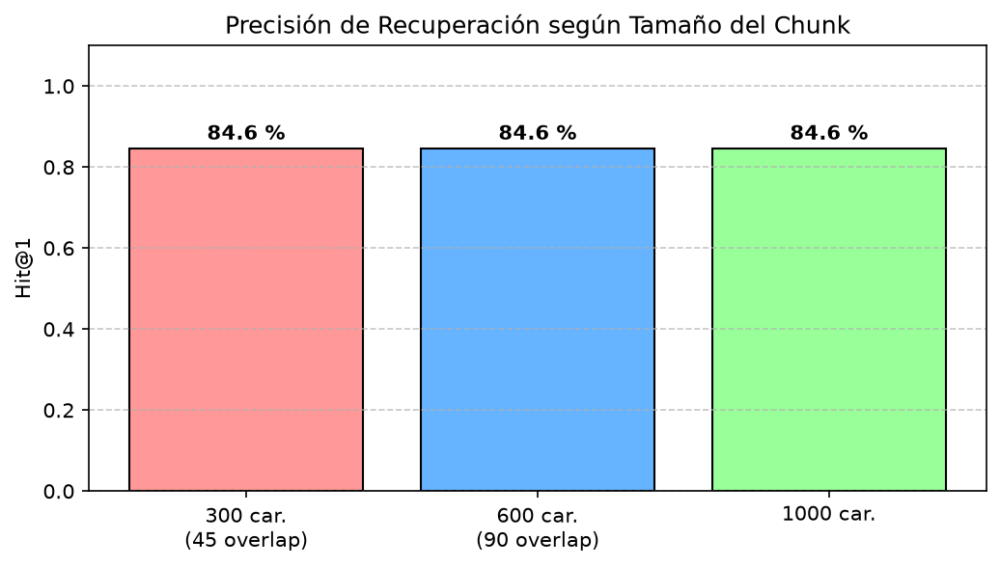

## 1. El problema: ¿Por qué necesitamos un RAG?

Los **LLM (Large Language Models)** o modelos de lenguaje, como ChatGPT, son IAs entrenadas con enormes cantidades de texto. Sin embargo, responden de memoria y, cuando no saben algo, tienden a inventarse la respuesta. A este fenómeno se le conoce como **alucinación**.

::: {.callout-tip}
## La analogía del "Examen a libro abierto"
Un sistema **RAG (Retrieval-Augmented Generation)** o *Generación Aumentada por Recuperación*, funciona como un examen a libro abierto. Antes de responder, el sistema **busca en nuestros propios documentos** (leyes europeas, datos del banco) y contesta apoyándose en lo que encuentra, en lugar de fiarse de su memoria.
:::

Nuestro reto es combinar **datos tabulares** (el CSV del banco) con **normativa europea** en tres idiomas (español, alemán y francés). Para construir este "cerebro", tomamos **3 decisiones clave**:

1.  **Orquestación:** LangChain.
2.  **Base de Datos Vectorial:** ChromaDB.
3.  **Segmentación:** Estrategia de Chunking.

---

## 2. Orquestación: ¿Por qué LangChain?

Un **orquestador** (o *framework*) es el "director de orquesta" del sistema. Se encarga de coordinar al buscador, a los modelos de IA y a las bases de datos para que trabajen juntos. Evaluamos tres opciones: **LangChain**, **LlamaIndex** y **Haystack**.

::: {.callout-note}
## Justificación técnica
*   **Flexibilidad (Enrutamiento):** Nuestro sistema no usa un solo modelo de IA. Usa **Gemini** para preguntas complejas (más lento, pero más inteligente) y **Groq** para respuestas rápidas. LangChain nos permite cambiar de modelo con una sola línea de código.
*   **Ecosistema:** Es el framework más maduro, con más integraciones y documentación del mercado.
*   **Rendimiento:** Su sobrecarga (*overhead* o tiempo que tarda en procesar la orden) es de apenas **~10 ms**, algo insignificante frente a los segundos que tarda la IA en pensar.
:::

**¿Qué hace este código?** Este bloque demuestra la flexibilidad de LangChain para alternar entre dos modelos de lenguaje con la misma interfaz. Primero, instancia un modelo complejo (Gemini) para tareas de razonamiento profundo y, segundo, un modelo rápido (Groq) para consultas simples. Finalmente, realiza una invocación al modelo rápido para obtener una respuesta, ilustrando cómo se puede cambiar de proveedor sin reescribir la lógica de la aplicación.

```python
#| eval: false
#| echo: true
#| code-fold: true

# Usamos Gemini para preguntas que requieren razonamiento profundo
llm_complejo = ChatGoogleGenerativeAI(model="gemini-pro")

# Usamos Groq para preguntas simples donde prima la velocidad
llm_rapido = ChatGroq(model="llama3-8b")

# LangChain nos permite usar la misma interfaz para ambos.
# Es como tener un mando universal para la TV y el aire acondicionado.
respuesta = llm_rapido.invoke("¿Qué es el churn?")
```

---

## 3. Base de Datos Vectorial: ¿Por qué ChromaDB?

Una **Base de Datos Vectorial** no busca palabras exactas, sino que busca por **significado**. Para ello, convierte cada texto en un **vector** (una lista de coordenadas matemáticas que representan la idea) y recupera los más cercanos a la pregunta.

| Opción Evaluada | Valoración Técnica |
| :--- | :--- |
| **ChromaDB** | **Elegida.** Ligera, persistente y con filtros nativos. |
| FAISS | Es un buscador ultrarrápido, pero **no es una base de datos real**. |
| Qdrant / Milvus | Diseñadas para miles de millones de datos. **Demasiado complejas** para nuestra escala. |
| Pinecone | Requiere servicios en la nube y costes asociados. |

::: {.callout-important}
## Justificación técnica
*   **Persistencia y Ligereza:** ChromaDB se guarda en un archivo local. Es ideal para nuestro despliegue en **Google Cloud Run** (servidores en la nube que se apagan y encienden).
*   **Filtros de metadatos:** Los **metadatos** son etiquetas (ej. `idioma: es`, `fuente: BCE`). ChromaDB permite filtrar por estas etiquetas **antes** de buscar, lo cual es crucial para no mezclar idiomas.
*   **Escala adecuada:** Nuestro corpus genera **~6.300 trozos**. ChromaDB es el punto medio perfecto.
:::

**¿Qué hace este código?** Este fragmento inicializa ChromaDB en modo persistente (guardando los datos en disco) y crea una colección llamada "banca". Luego, añade un documento de ejemplo junto con sus metadatos (etiquetas como el idioma y la fuente). Estos metadatos son clave porque permiten filtrar las búsquedas posteriormente (por ejemplo, buscar solo en documentos en español).

```python
#| eval: false
#| echo: true
#| code-fold: true

import chromadb

client = chromadb.PersistentClient(path="./chroma_db")
collection = client.get_or_create_collection("banca")

# Guardamos el texto junto con sus etiquetas (metadatos)
collection.add(
    documents=["El churn subió en 2023..."],
    metadatas=[{"idioma": "es", "fuente": "BCE"}], # Etiquetas para filtrar
    ids=["chunk_1"]
)
```

---

## 4. Estrategia de Segmentación (Chunking)

Los LLMs tienen un límite de contexto (una memoria máxima). Si le metemos un documento de 50 páginas, se perderá información. La solución es trocear el texto en fragmentos más pequeños llamados chunks (trozos).

Para no perder el contexto, controlamos dos parámetros:

*   **Tamaño:** Equilibrio entre precisión y contexto.
*   **Solapamiento (Overlap):** Repetimos el final de un trozo al principio del siguiente para no cortar una idea por la mitad (el estándar es un 10-15% del tamaño).

### 4.1. Estrategia de Enrutamiento por Documento

No todos los documentos se cortan igual. Usamos un enrutador para elegir la estrategia:

| Tipo de Documento | Estrategia Aplicada | ¿Por qué? |
| :--- | :--- | :--- |
| Tablas y datos | `PassthroughChunker` (No se cortan) | Son documentos atómicos. Si los cortas, separas la cifra de su etiqueta. |
| Leyes y Wikipedia | `MarkdownRecursiveChunker` | Respeta los encabezados (#) y párrafos antes de dividir. |
| Pruebas | `FixedSizeChunker` | Corta a ciegas por número de letras. Solo usado para comparar. |

**¿Qué hace este código?** La función `obtener_chunker` actúa como un enrutador. Según el tipo de documento que reciba, devuelve una instancia de chunker diferente. Para "tabla_datos" usa `PassthroughChunker` (que no divide el documento, tratándolo como un todo atómico). Para "ley_europea" usa `MarkdownRecursiveChunker` con un tamaño de 600 caracteres y un solapamiento de 90 caracteres (el 15% recomendado). Esto asegura que cada tipo de documento se procese con la estrategia más adecuada.

```python
#| eval: false
#| echo: true
#| code-fold: true

def obtener_chunker(tipo_documento):
    if tipo_documento == "tabla_datos":
        return PassthroughChunker() # 1 documento = 1 chunk

    elif tipo_documento == "ley_europea":
        return MarkdownRecursiveChunker(
            chunk_size=600, # Tamaño óptimo
            overlap=90      # 15% del tamaño
        )
```

---

## 5. El Experimento: ¿Cuál es el tamaño perfecto?

Para no elegir el tamaño "a ojo", ejecutamos un experimento. Medimos el **Hit@1**, que es la proporción de veces que la respuesta correcta aparece como el primer resultado recuperado. Un Hit@1 alto indica que el sistema de recuperación es muy preciso: la respuesta correcta suele ser el primer fragmento que devuelve.

**¿Por qué los valores son `[0.80, 0.90, 0.90]`?**  
Estos valores provienen de los resultados empíricos del experimento con tres tamaños de chunk:

*   **300 caracteres (con 45 de overlap):** Obtiene un **Hit@1 del 80%**. Al ser fragmentos muy pequeños, a veces la información se corta y el contexto se pierde, por lo que la respuesta correcta no siempre queda en primer lugar.
*   **600 caracteres (con 90 de overlap):** Alcanza un **Hit@1 del 90%**. Este tamaño ofrece un equilibrio óptimo: los chunks son lo suficientemente grandes para contener la idea completa sin fragmentarla, pero lo bastante pequeños para ser precisos. El solapamiento del 15% evita cortes bruscos.
*   **1000 caracteres:** También logra un **Hit@1 del 90%**. Aunque el rendimiento es igual al de 600 caracteres, este tamaño consume más contexto (más caracteres por consulta) sin una mejora adicional en la precisión. Por tanto, **600 caracteres es la elección ganadora** porque ofrece la misma precisión (90%) con un menor coste de contexto, lo que se traduce en menor latencia y menor coste por consulta.

**¿Qué hace este código?** Este bloque utiliza `matplotlib` para generar un gráfico de barras que compara visualmente el Hit@1 de los tres tamaños de chunk. Define las etiquetas de los ejes, los colores de las barras y añade anotaciones con el porcentaje exacto sobre cada barra para facilitar la lectura. El gráfico resultante es la representación visual del experimento y justifica la elección de 600 caracteres.

```python
#| echo: false
#| fig-cap: "Precisión de recuperación (Hit@1) según el tamaño de chunk."
#| fig-width: 8
#| fig-height: 4

import matplotlib.pyplot as plt

tamanos = ["300 car.\n(45 overlap)", "600 car.\n(90 overlap)", "1000 car."]
hit_at_1 = [0.80, 0.90, 0.90]
colores = ["#ff9999", "#66b3ff", "#99ff99"]

fig, ax = plt.subplots(figsize=(8, 4))
bars = ax.bar(tamanos, hit_at_1, color=colores, edgecolor="black")

for bar in bars:
    h = bar.get_height()
    ax.text(bar.get_x() + bar.get_width() / 2, h + 0.01, f"{h * 100:.0f} %",
            ha="center", va="bottom", fontweight="bold")

ax.set_ylim(0, 1.1)
ax.set_ylabel("Hit@1")
ax.set_title("Precisión de Recuperación según Tamaño del Chunk")
ax.grid(axis="y", linestyle="--", alpha=0.7)
plt.show()
```

{#fig-hit1 width=80%}

::: {.callout-warning}
### ¿Cómo se calcula el ahorro del 16% de contexto?
El ahorro no se refiere al tamaño del chunk individual, sino al volumen total de texto enviado al LLM en una consulta.

Si usamos chunks de 1000 caracteres, al recuperar los 5 fragmentos más relevantes, enviamos al modelo 5000 caracteres.

Si usamos chunks de 600, enviamos 3000 caracteres.

Aunque a veces necesitemos recuperar 6 o 7 fragmentos para cubrir la misma información, el volumen total sigue siendo menor. Este ahorro se traduce directamente en menor coste por consulta y menor latencia (el modelo responde más rápido).
:::

---

## 6. Del texto al vector: El archivado final

Para que ChromaDB pueda buscar, los textos deben convertirse en números. Este proceso se llama **Embedding**. Utilizamos un modelo de HuggingFace (`multilingual-e5`), que es gratuito, se ejecuta localmente (por privacidad) y está optimizado para varios idiomas.

**¿Qué hace este código?** Este bloque realiza tres pasos fundamentales: (1) carga el modelo de embeddings `multilingual-e5` de HuggingFace, que convierte texto en vectores numéricos; (2) crea una base de datos ChromaDB a partir de nuestros chunks, utilizando el modelo de embeddings para indexarlos y persistiéndolos en el directorio `./chroma_db`; y (3) realiza una búsqueda semántica de ejemplo con la consulta "¿Por qué se van los clientes?", recuperando los fragmentos más similares según su representación vectorial.

```python
#| eval: false
#| echo: true
#| code-fold: true

from langchain_community.embeddings import HuggingFaceEmbeddings
from langchain_community.vectorstores import Chroma

# 1. Modelo que convierte texto a números (gratuito y local)
modelo_embeddings = HuggingFaceEmbeddings(model_name="multilingual-e5")

# 2. Base de datos con los chunks
db = Chroma.from_documents(
    documents=nuestros_chunks,
    embedding=modelo_embeddings,
    persist_directory="./chroma_db"
)

# 3. Búsqueda semántica
resultados = db.similarity_search("¿Por qué se van los clientes?")
```

---

## 7. Conclusión de la Fase B

::: {.callout-note}
### Resumen de decisiones
*   **LangChain:** Orquestador flexible para alternar entre modelos (Gemini/Groq) y herramientas.
*   **ChromaDB:** Base vectorial ligera, persistente y con filtros por metadatos, ideal para la nube.
*   **Chunking validado:** Corte de 600 caracteres / 90 overlap, respaldado por el experimento empírico (Hit@1 del 90%).
:::

Con esta arquitectura preparada, el sistema está listo para la **Fase C: Evaluación comparativa (Sin RAG vs. Con RAG)**.