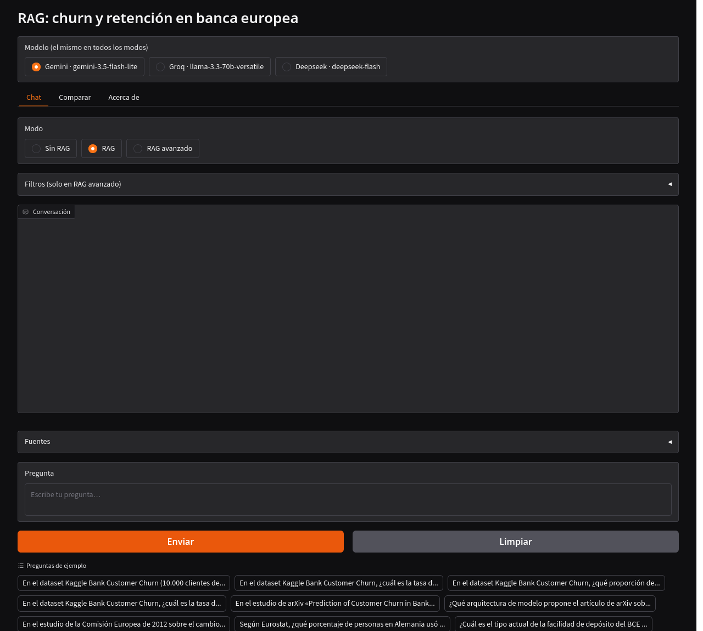

```{python}
#| echo: false
import sys
sys.path.insert(0, ".")
from _helpers import show_file
```

## Qué se publica y dónde

| Pieza | Dónde vive | Cómo se actualiza |
|---|---|---|
| **Aplicación** (Gradio) | Google Cloud Run | `gcloud builds submit` con `deploy/cloudbuild.yaml` |
| **Documentación** (este sitio, Quarto) | GitHub Pages | Flujo de GitHub Actions al hacer *merge* en `main` |
| **Código, datos y resultados** | GitHub, carpeta `rag_project/` | *Pull request* por etapa, revisado por el equipo |

## La aplicación

**Enlace público: <https://rag-churn-6lkxbo5a5a-ew.a.run.app/>** (Gradio, desplegada en Google Cloud Run).
Las etiquetas están en español; las respuestas se dan siempre en español, sea cual sea el idioma de la pregunta.

{fig-alt="Interfaz de la aplicación"}

- **Selector de modelo** (arriba de las pestañas): **Gemini** por defecto, o **Groq** y **DeepSeek**. El mismo modelo
  se usa en todos los modos, así que la comparación sigue siendo justa. Si el servidor no tiene la clave del
  proveedor elegido, la aplicación lo dice con un mensaje claro y se puede volver a Gemini.
- **Chat**: tres modos (*Sin RAG*, *RAG*, *RAG avanzado*), tiempo de respuesta, la ruta que eligió el enrutador y un
  acordeón **Fuentes**. Cada fuente muestra el título, un enlace para **abrir el documento original**, el origen, la
  puntuación y el texto del fragmento, con una letra algo más pequeña para que se lea mejor.
- **Filtros** (solo en RAG avanzado): tipo de fuente, geografía e idioma.
- **Comparar**: la misma pregunta en los tres modos, en columnas. Debajo, las **fuentes de RAG y de RAG avanzado
  una junto a la otra**, para ver de un vistazo qué fragmentos recupera cada técnica. Es la mejor demostración en
  directo de la tesis del proyecto.
- **Acerca de**: qué datos hay y la advertencia de que las respuestas se basan solo en los documentos recuperados.
- Botones con las preguntas de evaluación, mensajes claros si el modelo está saturado (se reintenta una vez) y rechazo
  de las preguntas que piden datos personales.

### Cómo se elige el modelo

El selector no cambia la configuración global: la aplicación construye **una cadena RAG por proveedor** la primera
vez que se usa y la reutiliza (`AppService` en `app/handlers.py`; `Container.chain(provider)` en `factory.py`). El
proveedor elegido en la interfaz no usa *fallbacks*: si falla, se informa en lugar de cambiar de modelo en silencio.

## Despliegue en Google Cloud Run

La aplicación se despliega como un **contenedor en Cloud Run**, que escala a cero y tiene una cuota gratuita mensual.

1. **Imagen**: un `Dockerfile` instala las dependencias de ejecución, y **hornea el modelo de embeddings y el
   índice de Chroma** en la imagen (el disco de Cloud Run es efímero; construirlos al arrancar repetiría 200 s
   en cada arranque en frío).
2. **Secretos**: la clave de Gemini está en *Secret Manager* y se monta como variable de entorno. No está en el
   repositorio ni en la imagen.
3. **Construcción y despliegue**: `gcloud builds submit` con `cloudbuild.yaml` (construye, publica en Artifact
   Registry y despliega con 2 GiB, 2 CPU, de 0 a 2 instancias).
4. **Coste**: alerta de presupuesto en la cuenta de facturación y un máximo de 2 instancias.

```{python}
#| echo: false
show_file("deploy/Dockerfile", max_lines=45)
```

### Paso a paso para desplegar

```bash
# 1. Una sola vez: guardar la clave de Gemini como secreto (nunca en el repositorio)
printf '%s' "$GOOGLE_API_KEY" | gcloud secrets create google-api-key --data-file=-

# 2. Construir la imagen, publicarla y desplegar (sube solo la carpeta del proyecto)
gcloud builds submit rag_project --config rag_project/deploy/cloudbuild.yaml \
  --substitutions=SHORT_SHA=v1,_CONTEXT=. --timeout=30m

# 3. Comprobar: la dirección del servicio y los últimos registros
gcloud run services describe rag-churn --region europe-west1 --format='value(status.url)'
gcloud run services logs read rag-churn --region europe-west1 --limit 30
```

Para probar la imagen **en local** antes de subirla (con Podman o Docker):

```bash
# Se ejecuta desde la carpeta rag_project/ (el contexto de construcción)
podman build -f deploy/Dockerfile -t rag-churn .
# -e pasa la clave como variable de entorno; --rm borra el contenedor al salir
podman run --rm -p 8080:8080 -e GOOGLE_API_KEY=... rag-churn   # http://localhost:8080
```

### Habilitar Groq y DeepSeek en producción

`cloudbuild.yaml` monta las tres claves (`google-api-key`, `groq-api-key`, `deepseek-api-key`), así que **los
secretos tienen que existir antes del despliegue**:

```bash
# Crear los tres secretos (vacíos); después se les añade una versión con la clave real
for s in google-api-key groq-api-key deepseek-api-key; do gcloud secrets create $s --replication-policy=automatic; done
printf '%s' "$GOOGLE_API_KEY"   | gcloud secrets versions add google-api-key   --data-file=-
printf '%s' "$GROQ_API_KEY"     | gcloud secrets versions add groq-api-key     --data-file=-
printf '%s' "$DEEPSEEK_API_KEY" | gcloud secrets versions add deepseek-api-key --data-file=-

# La cuenta con la que se ejecuta el servicio debe poder leerlos
# (SA = cuenta de servicio de Cloud Run)
SA=$(gcloud run services describe rag-churn --region europe-west1 --format='value(spec.template.spec.serviceAccountName)')
for s in google-api-key groq-api-key deepseek-api-key; do
  gcloud secrets add-iam-policy-binding $s --member="serviceAccount:$SA" --role=roles/secretmanager.secretAccessor
done
```

Si un proveedor no tiene clave, la aplicación sigue funcionando con los demás y muestra que falta esa clave.
DeepSeek es de pago por uso (sin cuota gratuita).

### Qué hacer si algo falla

| Síntoma | Causa probable | Solución |
|---|---|---|
| "El proveedor del modelo está saturado" | Límite de peticiones de la cuota gratuita | Esperar unos segundos o elegir otro modelo |
| "Falta la clave de API de …" | Secreto no montado para ese proveedor | Crear el secreto y volver a desplegar |
| Primera respuesta lenta | Arranque en frío (escala a cero) | Normal; con `--min-instances 1` se evita en una demostración |
| Versión nueva con errores | Cambio defectuoso | `gcloud run services update-traffic rag-churn --to-revisions=<anterior>=100` |

### Reducir el tamaño y el tiempo de construcción

Medido con `podman build`: la imagen pasó de **4,67 GB a 2,76 GB**. El mayor ahorro (1,74 GB) era la caché de
ruedas de `uv`, que se quedaba dentro de la capa (`--no-cache`). Además, los paquetes que solo usa el pipeline de
datos (pymupdf, kagglehub, bs4, lxml, markdownify) van en un grupo de dependencias que la imagen no instala, y las
capas están ordenadas de menos a más cambiantes (dependencias, modelo e índice, aplicación): un cambio solo en la
interfaz reutiliza el índice (1 s frente a unos 208 s). `cloudbuild.yaml` usa la imagen anterior como caché.

::: {.callout-note}
## Limitaciones
El modelo de embeddings (470 MB) y torch (805 MB) siguen en la imagen. Cambiarlos modificaría los vectores y los
resultados. Tras un periodo sin tráfico, el primer arranque en frío tarda unos segundos más (con `--min-instances 1`
se evita para una demostración).
:::

## Documentación con Quarto

Este sitio está escrito en **Quarto** (`rag_project/docs/`, páginas `.qmd`) y no contiene cifras copiadas a mano:
las tablas, los gráficos y los ejemplos **leen los resultados guardados** en `eval/` y los documentos de
`data/processed/` mediante funciones de ayuda (`docs/_helpers.py`), y el código que se muestra se recorta de los
ficheros reales con `ast`, de modo que lo que se ve aquí es lo que hay en el repositorio. Por eso el sitio se puede
generar sin claves de API ni descargas.

| Página | Contenido |
|---|---|
| Inicio y Datos | Motivación, tema, dataset y procedencia de las fuentes |
| Pipeline | Descarga, limpieza y documentos derivados, con extractos de código |
| Chunking y vector DB | Por qué LangChain y ChromaDB, el tamaño de *chunk* y su experimento |
| Evaluación | Sin RAG frente a con RAG, métricas automáticas y ejemplos |
| RAG avanzado | Búsqueda híbrida, enrutador, filtros y reranking, con la ablación |
| App y despliegue | Esta página |
| Equipo | Autores y referencias |

**Tema claro y oscuro:** el sitio incluye un interruptor en la barra de navegación (icono de la luna/sol). Se
configura en `docs/_quarto.yml` con `theme: {light: cosmo, dark: darkly}`; Quarto recuerda la elección del lector.

Para trabajar en las páginas en local:

```bash
uv sync --group docs            # una vez: entorno de documentación (Jupyter, matplotlib)
uv run quarto preview docs      # vista previa que se recarga al guardar
uv run poe docs                 # genera el sitio completo en docs/_site
```

Para añadir una página basta crear el `.qmd` y listarlo en `docs/_quarto.yml`, en la barra lateral (que fija el orden
de los botones *Anterior / Siguiente*) y en el menú *Contenido*.

## Publicación del sitio (GitHub Pages)

El sitio se publica con un flujo de GitHub Actions, `.github/workflows/rag_project-docs.yml`. Como el repositorio
contiene también el primer proyecto, el flujo vive en la raíz (GitHub solo ejecuta ahí los flujos), tiene el prefijo
`rag_project-` y se activa **solo con cambios en `rag_project/`**.

| Evento | Qué hace |
|---|---|
| *Pull request* con cambios en `docs/` o `eval/` | Genera el sitio para comprobar que compila (no publica) |
| *Push* a `main` | Genera el sitio y lo **publica** en GitHub Pages |
| Ejecución manual | Igual que un *push* a `main` |

Los pasos del trabajo `build` son: instalar `uv` y el entorno de documentación bloqueado (`uv sync --frozen --group
docs`), instalar Quarto (versión fijada), ejecutar `quarto render docs` y subir `docs/_site` como artefacto; el
trabajo `deploy` lo publica con `actions/deploy-pages`. Requiere una sola vez en el repositorio
*Settings → Pages → Source = GitHub Actions*.

::: {.callout-tip}
## Flujo de trabajo del equipo
Cada etapa va en su propia rama y en un *pull request*: la comprobación del sitio se ejecuta automáticamente y,
tras la revisión del equipo y el *merge* a `main`, se publican la documentación y, con `gcloud builds submit`, la
aplicación.
:::
