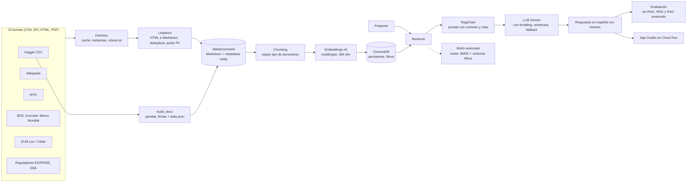
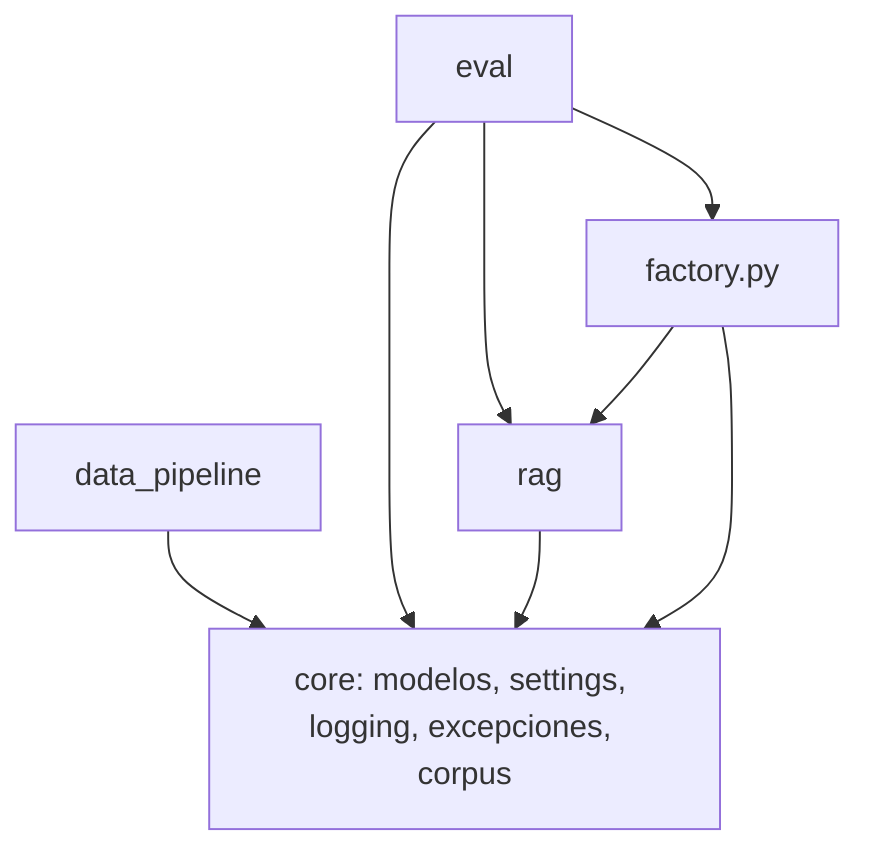
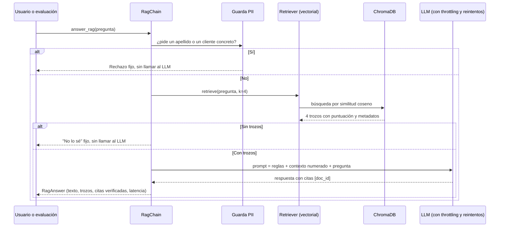

# 01. Visión general y arquitectura

## 1. Qué hace el proyecto en una frase

Es un sistema **RAG** (*Retrieval-Augmented Generation*, generación aumentada por recuperación) sobre **retención y churn de clientes en la banca minorista europea (Francia, Alemania, España)**, completamente automatizado, que demuestra de forma medible que **el mismo LLM responde mejor con recuperación de documentos que sin ella**.

Se parte del dataset de Kaggle *Bank Customer Churn* (el mismo tema del proyecto 1, que entrenó un modelo de predicción). **Este proyecto no predice churn**: usa solo el dataset como base y lo combina con fuentes públicas (papers, Wikipedia, datos del BCE, Eurostat, Banco Mundial, legislación de la UE, reguladores).

## 2. Qué es RAG y por qué se compara con "sin RAG"

Un LLM sabe lo que vio al entrenarse, hasta una fecha de corte, y no conoce tus datos privados o muy recientes. RAG soluciona eso en tres pasos:

1. **Recuperar**: dada la pregunta, buscar los fragmentos de texto más relevantes en una base de conocimiento.
2. **Aumentar**: meter esos fragmentos en el *prompt* junto con la pregunta.
3. **Generar**: el LLM responde **usando solo ese contexto** y citando las fuentes.

La comparación experimental exige que **lo único que cambie sea la recuperación**: mismo modelo, mismas preguntas.

Ejemplo real del proyecto (pregunta D1, "¿cuál es la tasa de churn de Alemania en el dataset?"):

| Modo | Respuesta |
|---|---|
| Sin RAG | "No sé la tasa exacta de cada país en ese dataset concreto." |
| Con RAG | "Alemania: 32,4 %, Francia: 16,2 %, España: 16,7 % [kaggle_summary_geography]" |

El modelo no puede conocer esas cifras porque **las calcula nuestro código a partir del CSV**; solo el RAG puede dárselas.

## 3. La decisión central de diseño: convertir el CSV en conocimiento, no incrustar filas

RAG no sirve para preguntas agregadas ("¿churn de Alemania?") si se indexan 10.000 filas sueltas: ninguna fila contiene la respuesta, y recuperar "las filas más parecidas" no calcula una media.

Solución adoptada (módulo `data_pipeline/build_docs.py`):

- Con **pandas** se calculan las estadísticas y se escriben como **documentos de texto**: fichas de segmento (por país, género, banda de edad, antigüedad, número de productos, tipo de tarjeta, etc.), diccionario de datos, resumen, y un documento de hallazgos.
- Hay **66 documentos derivados** del CSV, y todas las cifras salen del código, no de nadie tecleándolas.
- Se guarda `data/processed/stats.json` con **cada número usado**, indexado por nombre (por ejemplo `geography.Germany.churn_rate`). Más adelante la evaluación **genera las respuestas correctas (gold) desde ese archivo**, de modo que el "gold" tampoco se escribe a mano.

## 4. Regla de privacidad

`RowNumber`, `CustomerId` y `Surname` son identificadores personales (aunque el dataset sea sintético). Se **eliminan antes de crear ningún documento** (`clean.drop_pii`), nunca se indexan, y una pregunta de la evaluación comprueba que el sistema **se niega** a revelar el apellido de un cliente. Hay además una verificación automática tras cada ejecución del pipeline (`pii_check.py`).

## 5. Diagrama de arquitectura



Lectura del diagrama: de izquierda a derecha hay **tres fases** que se ejecutan por separado:

1. **Ingesta** (`data_pipeline`): produce `data/processed/`.
2. **Indexación** (`rag.index`): trocea, calcula vectores y rellena ChromaDB.
3. **Consulta** (`rag.chain`): en tiempo de pregunta, recupera y genera. La evaluación y la app usan esta fase.

## 6. Mapa de carpetas

```
rag_project/
├── config.yaml              Toda la configuración (rutas, fuentes, chunking, modelos, k)
├── pyproject.toml / uv.lock Dependencias fijadas, herramientas de calidad, tareas poe
├── .env.example             Solo nombres de variables (las claves reales van en .env, no se versionan)
├── factory.py               Raíz de composición: único sitio que construye y conecta componentes
├── core/                    Piezas compartidas: configuración, modelos de dominio, logging, excepciones, lector del corpus
├── data_pipeline/           FASE 1: descargar, limpiar y generar documentos
│   ├── fetchers/            Un módulo por fuente (más base.py con la plantilla y el registro)
│   ├── http.py, cache.py, resilience.py   Cliente educado, caché de descargas, reintentos y límite de ritmo
│   ├── clean.py, build_docs.py            Limpieza de texto; estadísticas con pandas y fichas
│   ├── writer.py, pii_check.py            Escritura de archivos y SOURCES.md; comprobación de privacidad
│   └── run_all.py           Orquestador con informe de ejecución
├── rag/                     FASES 2 y 3: chunking, embeddings, base vectorial, LLM, cadena RAG, búsqueda híbrida, reranking y router
├── eval/                    Preguntas, respuestas gold generadas, ejecución, puntuación, experimento de chunking y ablación
├── app/                     App Gradio: punto de entrada, servicio con manejo de errores e interfaz
├── deploy/                  Dockerfile y cloudbuild.yaml para Cloud Run
├── docs/                    Sitio Quarto en español (solo .qmd, estilos y ayudantes)
├── documentacion/           Esta guía de presentación (Markdown, separada del sitio)
├── data/
│   ├── raw/                 Caché de descargas (NO se versiona)
│   ├── processed/           Corpus final en Markdown + stats.json (SÍ se versiona, es pequeño)
│   └── SOURCES.md           Tabla autogenerada de fuentes, licencias y fechas
├── chroma_db/               Índice vectorial (NO se versiona; se reconstruye)
├── tests/                   unit/ (offline), integration/ (red, LLM; marcados), fixtures/
├── README.md                Cómo reproducir todo
└── PROGRESS.md              Diario de etapas, decisiones y problemas abiertos
```

### Regla de dependencias entre paquetes



- `data_pipeline` y `rag` **no se importan entre sí**. Lo compartido vive en `core/`. Así, el pipeline puede cambiarse sin tocar la parte de consulta.
- Excepción documentada: `eval/score.py` usa `data_pipeline.pii_check.load_identifiers` para detectar si una respuesta filtra un apellido real.

## 7. Aislamiento del proyecto 1

El proyecto 1 (modelo de predicción de churn en `bank-churn-prediction/`) **no se importa, no se depende de él y no se modifica**. El único vínculo es el dataset de origen. Este proyecto tiene su propio `pyproject.toml`, `uv.lock` y `.venv/`. La única excepción es el workflow de GitHub Pages, que debe vivir en la raíz del repositorio (`.github/workflows/rag_project-docs.yml`, filtrado a `rag_project/**`).

## 8. Stack y por qué

| Componente | Elección | Motivo principal |
|---|---|---|
| Lenguaje y entorno | Python 3.12 con **uv** (`.venv/`, `uv.lock`) | Instalaciones reproducibles y rápidas; 3.12 porque el sistema tenía 3.14, demasiado nuevo para varias librerías (torch, chromadb) |
| Orquestación LLM | **LangChain** (modelos de chat de los proveedores y divisores de texto) | Integraciones listas con Gemini, Groq y DeepSeek |
| Base vectorial | **ChromaDB** persistente | Filtros por metadatos, sin servidor, el índice cabe dentro de la imagen del contenedor |
| Embeddings | `intfloat/multilingual-e5-small` | Multilingüe (EN/ES/FR/DE) y pequeño: corre en CPU gratuita |
| LLM | Gemini (`gemini-3.5-flash-lite`), con Groq y DeepSeek como alternativas | Gemini tiene capa gratuita; selector en configuración |
| Reranking | FlashRank TinyBERT, mezclado con el orden híbrido (peso 0,7) | Local, sin clave |
| Búsqueda léxica | `rank_bm25` | Búsqueda híbrida con la vectorial |
| Interfaz | Gradio (Blocks), en español | Python puro, corre en un solo contenedor |
| Despliegue | Docker/Podman + Google Cloud Run | Escala a cero con cuota gratuita |
| Documentación | Quarto en GitHub Pages | Requisito de la entrega |
| Calidad | ruff, mypy (modo estricto), pytest + cobertura, pre-commit, poethepoet | Ver `07_ingenieria_patrones_y_calidad.md` |

## 9. Flujo completo de una pregunta



Puntos que conviene saber explicar:

- La **guarda de privacidad** y el caso de **contexto vacío** no llaman al LLM: son deterministas, baratos y no pueden "alucinar".
- Las **citas** que el modelo escribe como `[doc_id]` se **verifican**: solo se cuentan si ese documento está realmente entre los trozos recuperados (`extract_citations`).
- El modo **sin RAG** (`answer_no_rag`) usa el mismo modelo pero **sin contexto ni guarda**: es una línea base limpia.
- El modo **RAG avanzado** (`answer_advanced`) cambia solo la recuperación: router por reglas y búsqueda híbrida BM25 + vectorial con filtros (ver `05_rag_avanzado.md`). El prompt y el LLM son los mismos.
- Todas las respuestas son **en español**, aunque la pregunta o los documentos estén en otro idioma.
