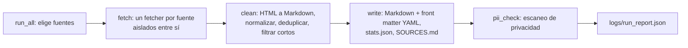

# 02. Pipeline de datos

Objetivo: que **un solo comando** reconstruya todo el corpus, sin ningún archivo cargado a mano, de forma **idempotente** (ejecutarlo dos veces da exactamente lo mismo) y **robusta** (si una fuente falla, las demás siguen).

```bash
uv run python -m data_pipeline.run_all                    # todas las fuentes habilitadas
uv run python -m data_pipeline.run_all --sources a1,a3    # solo algunas (a2 es alias de a1)
uv run python -m data_pipeline.run_all --refresh          # ignora la caché de descargas
```

## 1. Las etapas del pipeline



| Etapa | Módulo | Qué hace |
|---|---|---|
| Descarga | `data_pipeline/fetchers/*` | Cada fuente descarga, cachea y devuelve `Document` con metadatos |
| Limpieza | `data_pipeline/clean.py` | Quita navegación y anuncios, convierte a Markdown, normaliza, elimina duplicados |
| Documentos del CSV | `data_pipeline/build_docs.py` | Estadísticas con pandas convertidas en texto |
| Escritura | `data_pipeline/writer.py` | Archivos `.md` deterministas y `data/SOURCES.md` |
| Privacidad | `data_pipeline/pii_check.py` | Verifica que no se cuelan identificadores |
| Orquestación | `data_pipeline/run_all.py` | Ejecuta todo, aísla fallos, genera el informe |

## 2. Las 13 fuentes

El plan clasifica las fuentes en niveles A (núcleo) y B (ampliadas). El corpus resultante es **multifuente, multiformato y multilingüe**, como pide la práctica.

| ID | Fuente | Formato | Idioma | Docs | Particularidad importante |
|---|---|---|---|---|---|
| A1/A2 | CSV de Kaggle y **documentos derivados** | CSV a texto generado | inglés | 63 | Descarga con `kagglehub` (anónima funciona); se eliminan columnas PII; `Complain` no genera fichas por ser fuga del objetivo; ver sección 5 |
| A3 | Papers de **arXiv** | PDF + API Atom | inglés | 11 | Solo metadatos, resumen y extractos (no el texto completo); curados con `exclude_ids`/`include_ids` (se descartaron 9 papers fuera de tema) |
| A4 | **Wikipedia** | JSON de la API MediaWiki | inglés | 16 | Licencia CC BY-SA: se guarda la URL; limita el ritmo (error 429) |
| A5 | **Portal de datos del BCE** | CSV SDMX | inglés | 13 | Tipos oficiales, inflación y tipos bancarios; cada serie es una nota corta con fecha |
| A6 | **Legislación de la UE** | HTML/XHTML/PDF | inglés | 8 | EUR-Lex sirve un reto anti-bots; hay cadena de alternativas. La ley de IA y el RGPD se reducen a los artículos pertinentes (`keep_articles`); incluye el informe de la Comisión sobre la Directiva de cuentas de pago |
| B1 | **Banco de España**, Portal del Cliente Bancario | HTML | español | 7 | Da texto en español (recuperación multilingüe) |
| B2 | **Eurostat** | JSON-stat | inglés | 15 | Una nota por indicador y país (FR, DE, ES) |
| B3 | **Banco Mundial** | JSON | inglés | 18 | Idem: inflación, PIB per cápita, crédito privado, cuentas bancarias, sucursales por 100.000 adultos y uso de internet |
| B4 | **Notas de prensa del BCE** | RSS + HTML | inglés | 3 | Solo lo que hay en el feed RSS (unas 15 entradas recientes) |
| B5 | **Encuesta de Finanzas y Consumo de los Hogares (HFCS)** | HTML + PDF | inglés | 3 | Página de la HFCS, su informe de investigación y el estudio SPACE 2024 sobre hábitos de pago; el BCE no ofrece las tablas por edad en una URL estable |
| B6 | **EBA** (Autoridad Bancaria Europea) | HTML + PDF | inglés | 5 | Páginas de consumidor, informe de originación de préstamos y el Informe de Tendencias del Consumidor 2024/25 |
| B7 | **Registros de crédito** (CIRBE, FICP) | HTML | español, francés | 2 | Explican por qué una puntuación de crédito no es comparable entre países |
| B8 | **Banque de France, BaFin, Bundesbank, Verbraucherzentrale** | HTML + PDF | inglés, francés, alemán | 12 | Cambio de banco (Francia y Alemania), reclamaciones y hábitos de pago; evita el sesgo hacia España |
| | **Total** | | | **177** | Unas 325.000 palabras |

Fuera de alcance por decisión del equipo: quejas del CFPB (EE. UU.) y Banking77, para mantener el foco europeo.

## 3. Clases y métodos clave (infraestructura común)

### `HttpClient` (`http.py`): el cliente "educado"
Todos los fetchers descargan a través de él.
- `get(url, params=, headers=, check_robots=True, min_interval=None)`: devuelve la respuesta o lanza `FetchError`.
- **Respeta `robots.txt`** (`_check_robots`, con caché por servidor). Las APIs públicas documentadas pasan `check_robots=False`.
- **Límite de ritmo** por servidor: mínimo 1 segundo entre llamadas (`RateLimiter`); arXiv exige más (3 s para la API, 15 s entre PDFs).
- **Reintentos con espera exponencial** ante 429, 5xx y errores de red (`call_with_retry`).
- Cabecera `User-Agent` descriptiva y genérica.

### `RateLimiter` y `call_with_retry` (`resilience.py`)
Piezas pequeñas y reutilizables (patrón *Decorator*): el reloj y el `sleep` son inyectables, por eso se prueban sin esperar de verdad.

### `RawCache` (`cache.py`)
Guarda cada descarga en `data/raw/<fuente>/` con un `manifest.json` (URL, fecha, hash). Método principal: `get_or_fetch(key, ext, download)`. La **fecha de recuperación** (`retrieved_at`) viene de este manifiesto, no de "hoy": es una de las claves de la **idempotencia**.

### `BaseFetcher` (`fetchers/base.py`): patrón *Template Method*
`fetch()` implementa **una sola vez** la caché, el aislamiento de errores y el registro de actividad. Cada subclase solo define tres cosas:
- `_items()`: qué hay que descargar (lista de `FetchItem`).
- `_download(item)`: cómo descargarlo (bytes).
- `_parse(item, payload)`: cómo convertirlo en `Document`.

Si un elemento falla, se registra el error y **se continúa con el siguiente**; el resultado (`FetchResult`) lleva documentos, errores y artefactos (por ejemplo `stats.json`).

### Registro de fetchers
`@register_fetcher("a4")` añade la clase al diccionario `FETCHER_REGISTRY`. **Añadir una fuente nueva = añadir una clase y un bloque en `config.yaml`**, sin editar el orquestador (principio abierto/cerrado). `load_all()` importa todos los módulos para que se ejecuten los decoradores.

## 4. Detalles por fuente (lo que suele preguntar el tribunal)

- **EUR-Lex (`eurlex.py`)**: la URL HTML responde 202 con cuerpo vacío (reto anti-bots de AWS). `is_challenge()` lo detecta y se usa una **cadena de alternativas**: EUR-Lex HTML, luego el XHTML de la Oficina de Publicaciones (Cellar) con `Accept: application/xhtml+xml`, luego PDF. `eurlex_to_markdown()` convierte las clases del Diario Oficial (`oj-ti-art`, `oj-sti-art`...) en encabezados `### Article N - título`, y aplana las tablas de numeración.
- **arXiv (`arxiv.py`)**: consultas con operadores `AND` (la frase entre comillas devolvía 0 resultados); reparto *round robin* entre consultas con tope; PDFs desde `arxiv.org/pdf` (el host `export.arxiv.org` los prohíbe en su `robots.txt`) con 15 s de espera. `select_sections()` extrae introducción, resultados/discusión y conclusión con una heurística de encabezados, y recorta cada sección. **Decisión de derechos**: no se republica el texto completo.
- **BCE (`ecb.py`)**: una nota por serie; para series de "fecha de cambio" (tipos oficiales) la nota dice "A fecha de {fecha de recuperación}, el tipo de la facilidad de depósito del BCE es 2,50 % (en vigor desde 2026-09-16)". Esto hace que la pregunta "¿cuál es el tipo actual?" solo se pueda responder con RAG.
- **Eurostat (`eurostat.py`)**: `parse_jsonstat()` aplana un cubo JSON-stat fijando el resto de dimensiones con filtros de consulta.
- **Páginas HTML (`html_pages.py`)**: `HtmlPageFetcher` es una plantilla; B1, B5, B6, B7 y B8 son subclases que solo fijan el nombre de la fuente y los valores por defecto. Las páginas están en `config.yaml`.

## 5. Convertir el CSV en conocimiento (`build_docs.py`)

Funciones **puras** (reciben un DataFrame y devuelven datos; fáciles de probar con un CSV pequeño de valores calculados a mano):

| Función | Qué calcula |
|---|---|
| `overview(df)` | Filas, abandonos, tasa global, desbalanceo de clases |
| `segment_stats(df, by)` | Por segmento: clientes, tasa de churn, medias de saldo, salario, puntuación de crédito, edad, puntos |
| `leakage_check(df)` | Cuánto "copia" `Complain` a `Exited` (fuga de objetivo) |
| `satisfaction_vs_churn(df)` | Si la puntuación de satisfacción predice el churn |
| `driver_scores(df)` | Correlación e información mutua de cada variable con el churn (con semilla fija: determinista) |
| `compute_stats(df)` | **Todos** los números, por nombre, para `stats.json` |
| `build_documents(...)` | Genera los 66 documentos |

Documentos generados: diccionario de datos, resumen, hallazgos, **fichas de segmento** (una por valor: país, género, banda de edad, antigüedad, número de productos, tipo de tarjeta, tarjeta de crédito, miembro activo, satisfacción, queja, y los cruces país × productos y país × actividad) y **resúmenes por dimensión** (tabla comparativa). Las fichas incluyen una frase en lenguaje llano ("los clientes con Geography = Germany se fueron al 32,4 %, es decir 1,59 veces la tasa global").

Hallazgos que calcula el código (no se teclean):
- Churn global 20,4 %; Alemania 32,4 %; 4 productos: 100 % (60 clientes); franja 50-59 años: 56,0 %.
- **Fuga de objetivo**: el 99,8 % de quienes se fueron habían presentado una queja (correlación 0,996). Un modelo de churn **no debe usar `Complain`**.
- La satisfacción no sigue al churn (entre 19,6 % y 21,8 % en las cinco puntuaciones).

## 6. Limpieza (`clean.py`)

Es una **cadena de pasos pequeños** aplicados en orden: `html_step` (quitar navegación y pasar a Markdown) → `normalize_step` (Unicode y espacios) → `dedupe_step` (hash del texto; gana el primer `doc_id`) → `min_length_step` (descarta lo vacío o diminuto). `clean_documents()` los ejecuta y ordena por `doc_id` (determinista).

`drop_pii(df)` elimina `RowNumber`, `CustomerId` y `Surname` **antes** de generar nada.

## 7. Escritura, privacidad e informe

- **`writer.py`**: cada documento va a `data/processed/<fuente>/<doc_id>.md` con **front matter YAML** (los metadatos). La limpieza de archivos obsoletos **solo ocurre dentro de las carpetas de fuentes que han producido documentos en esta ejecución**, así una fuente caída no borra su corpus anterior. `SOURCES.md` se genera leyendo `data/processed`.
- **`pii_check.py`**: reglas acordadas: (1) ningún `CustomerId` en ningún sitio; (2) ningún apellido en los documentos derivados del dataset, comparado **tal cual está en el CSV** (distingue mayúsculas, porque palabras como "band" o "see" también son apellidos y aparecen en minúsculas en nuestras plantillas); (3) los apellidos que coinciden en texto externo (autores, palabras comunes) se **registran como colisiones**, no como fallo.
- **`run_all.py`**: `run_fetchers()` aísla cada fetcher; `write_report()` produce `logs/run_report.json` (documentos y palabras por fuente, fallos, formatos, idiomas, resultado de privacidad).

## 8. Metadatos obligatorios (sección 5.3 del plan)

Cada documento, y después cada chunk, lleva: `doc_id`, `title`, `source`, `source_type` (dataset_stats, paper, encyclopedia, regulation, macro_data, regulator_guide, press), `url`, `language` (en/es/fr/de), `geography` (FR/DE/ES/EU/global/US), `topic`, `columns` (columnas del dataset a las que se vincula), `date`, `retrieved_at`, `license`, `format`. Sirven para **filtrar** (por país, idioma, tipo), **citar** y **explicar el origen**.

## 9. Idempotencia: cómo se demostró

Tras la primera ejecución completa se hizo una copia de `data/processed/`, se volvió a ejecutar el pipeline con la caché y se comparó con `diff -r`: **sin ninguna diferencia**. Las claves de la idempotencia son: fecha de recuperación tomada del manifiesto, orden estable de documentos, escritura en bytes (sin traducción de saltos de línea) y limpieza segura de obsoletos.

## 10. Problemas reales encontrados y cómo se resolvieron

| Problema | Causa | Solución |
|---|---|---|
| `export.arxiv.org/pdf` bloqueado | Su `robots.txt` lo prohíbe | Usar `arxiv.org/pdf`, que lo permite, con 15 s de espera |
| Wikipedia respondía 429 | Demasiadas peticiones seguidas | Intervalo de 2 s y reintentos con espera exponencial |
| Una página del Banque de France se vaciaba | `<body class="layout-no-sidebars">` coincidía con la regla "sidebar" y se borraba todo el contenido | Los contenedores (`html`, `body`, `main`, `article`) están exentos de la regla de clases |
| Falsos positivos de privacidad | "band" y "see" son apellidos del CSV y aparecían en nuestras plantillas | Comparación exacta (mayúsculas) en documentos derivados; el front matter se excluye del escaneo |
| Segmentos numéricos con etiqueta "4.0" | `iterrows()` de pandas convierte la fila a decimal | Las etiquetas de grupo se pasan a texto antes de generar nombres y claves |
| EUR-Lex devolvía una página vacía | Reto anti-bots | Detección y alternativa por Cellar (XHTML y PDF) |

## 11. Preguntas probables

- *¿Cómo garantizáis que es automático?* Un comando; sin archivos manuales; la fuente de Kaggle se descarga con `kagglehub`.
- *¿Qué pasa si una web cambia o bloquea?* Ese elemento falla, se registra en el informe y el resto continúa; el corpus anterior de esa fuente no se borra.
- *¿Por qué respetáis robots.txt y limitáis el ritmo?* Es ético y evita bloqueos; está en los requisitos del plan.
- *¿Cómo demostráis que no se filtra información personal?* Se eliminan antes de crear documentos y hay una verificación automática tras cada ejecución, más una pregunta de evaluación sobre el apellido de un cliente.
- *¿Por qué no indexar las filas del CSV?* Porque las preguntas son agregadas; ninguna fila contiene la respuesta.
