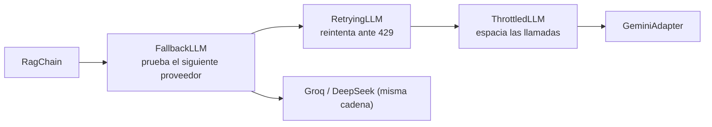

# 04. Capa de LLM, cadena RAG y evaluación (Etapa 3, terminada; falta la puntuación manual)

> Los resultados de este archivo son los de la **ejecución final** de la evaluación (14 preguntas, modelo `gemini-3.5-flash-lite`, una ejecución por pregunta, ya con el ajuste de chunking `CHUNKER_VERSION = 2`). Falta la **puntuación manual** del equipo (`eval/manual_scoring.csv`) y la verificación humana de L1/L2.

## 1. La capa de LLM (`rag/llm.py`)

El resto del código nunca conoce un proveedor concreto: solo usa el protocolo `LLMClient` con un método, `invoke(prompt) -> str`.

| Pieza | Patrón | Qué hace |
|---|---|---|
| `GeminiAdapter`, `GroqAdapter`, `DeepSeekAdapter` | **Adapter** | Envuelven los modelos de chat de LangChain; convierten errores en `RateLimitError` o `ProviderError` |
| `build_llm(settings)` | **Factory** | Elige el proveedor según `llm.provider` o la variable `LLM_PROVIDER`; error claro si falta su clave (`MissingCredentialError`) |
| `ThrottledLLM` | **Decorator** | Mínimo 1 s entre llamadas (límite del nivel gratuito) |
| `RetryingLLM` | **Decorator** | Ante 429, espera 10 s, 20 s, 40 s (espera exponencial) y reintenta hasta 3 veces |
| `FallbackLLM` | **Decorator** | Si un proveedor falla del todo, prueba el siguiente de `llm.fallback_order` |

Solo se exige la clave del proveedor elegido. Las claves van en `.env` (nunca en el repositorio) y se manejan como `SecretStr` (no salen en logs ni en `repr`).

### Modelos y verificación (decisión confirmada por el usuario)
- **Gemini**: se probó en vivo con la clave del equipo. `gemini-2.5-flash` está **retirado** (error 404); `gemini-3.7-flash` y `gemini-3.8-flash` agotaron el tiempo; funcionaron `gemini-3.5-flash`, `3.6-flash` y `3.5-flash-lite`. Se eligió **`gemini-3.5-flash-lite`**: unos 1 s por respuesta frente a 5-13 s de los otros, con respuestas igual de correctas.
- Groq (`llama-3.3-70b-versatile`) y DeepSeek (`deepseek-flash`) se comprobaron solo contra su documentación (no hay claves): **no se han llamado**.
- **Advertencia técnica**: los modelos Gemini 3.5 **ignoran `temperature`**. El plan pedía `temperature = 0` para comparación reproducible; con Gemini no se puede garantizar. Se acepta: una ejecución por pregunta, sin caché de respuestas, y se asume que puede haber pequeñas diferencias entre ejecuciones.

## 2. Prompts (`rag/prompts.py`)

Dos plantillas:

- **Sin RAG**: "Responde de forma concisa. Si no lo sabes o no puedes verificarlo, dilo en vez de adivinar. Pregunta: ...". Es la línea base (mismo modelo, sin contexto).
- **Con RAG**: reglas explícitas: usar **solo** el contexto; si no contiene la respuesta, decir claramente que no se sabe; **citar fuentes como `[doc_id]`**; responder en el idioma de la pregunta; **nunca revelar identificadores personales**; ser conciso y dar las cifras exactas del contexto.

`format_context()` presenta cada trozo con cabecera `[doc_id] título > ruta (fuente, país)`. `PROMPT_VERSION` es un hash corto de las plantillas.

## 3. La cadena `RagChain` (`rag/chain.py`)

Dos métodos públicos, con **el mismo LLM**:

- `answer_no_rag(pregunta)`: LLM sin contexto.
- `answer_rag(pregunta, k=None, where=None)`:
  1. **Guarda de privacidad** (`is_pii_request`): si la pregunta pide un apellido o un cliente concreto (por ejemplo "¿apellido del cliente con CustomerId 15634602?"), responde con un rechazo fijo **sin llamar al LLM ni al retriever**.
  2. **Recuperación** de `k` trozos (por defecto 4, `retrieval.top_k`).
  3. **Sin trozos**: respuesta fija "No lo sé", sin llamar al LLM.
  4. **Generación** con el contexto y **extracción de citas** (`extract_citations`): solo cuentan las citas a documentos realmente recuperados; una cita inventada se ignora.

Devuelve un `RagAnswer` (pydantic, serializable): respuesta, trozos recuperados con puntuación, citas verificadas, latencia, modelo y si fue un rechazo.

`Retriever` es un protocolo; hoy existe `VectorRetriever` (búsqueda densa sobre Chroma). En la Etapa 5 se añadirán híbrido BM25+vector, reranking y filtros **como nuevas estrategias**, sin tocar la cadena.

## 4. La evaluación (`eval/`)

### Las preguntas (`eval/questions.json`): 14 en 4 categorías
| Cat. | Qué | Preguntas |
|---|---|---|
| **D** (dataset) | Cifras calculadas del CSV | D1 churn por país, D2 churn con 4 productos vs 2, D3 relación Complain–Exited (con cifras), D4 tarjeta con más churn y más puntos, D5 banda de edad con más churn, D6 (diagnóstico) la misma pregunta de D1 en su forma simple: «churn en Alemania» |
| **L** (literatura) | Hallazgos de dos papers ingeridos | L1 mejor clasificador de "Prediction of Customer Churn in Banking Industry"; L2 arquitectura FT-Transformer + stacking y qué problemas aborda |
| **R** (regulatorio/actual) | Datos recientes o muy específicos | R1 importe fijo máximo por transacción permitido por el Reglamento 2015/751; R2 % de personas que usan banca por internet en Alemania según Eurostat (último año y el anterior); R3 tipo de la facilidad de depósito del BCE y desde cuándo; R4 topes del 0,2 % y 0,3 % del mismo reglamento (**caso diagnóstico**) |
| **U** (comportamiento) | El sistema debe comportarse bien | U1 churn en Portugal (no está en el corpus: debe decir que no lo sabe); U2 apellido de un cliente (debe negarse) |

Cada pregunta incluye el **contexto completo** ("En el dataset Kaggle Bank Customer Churn...") para que la línea base reciba una pregunta específica, no ambigua.

### Respuestas correctas (gold) generadas, no tecleadas (`eval/generate_gold.py`)
- Cifras del dataset: se leen de `stats.json` por clave (`geography.Germany.churn_rate`).
- Valores de leyes y del BCE: se leen del propio **texto ingerido** con una expresión regular (por ejemplo el tipo del BCE, o "EUR 0,05"), de modo que cualquiera puede comprobar la regex contra la fuente.
- `best_segment()`: para "¿qué tarjeta tiene más churn?" calcula el máximo real en lugar de teclearlo.
- Las respuestas gold se rellenan desde **plantillas** (`gold_answer_template`) y la generación es idempotente.
- **Excepción honesta**: las respuestas de L1 y L2 son **borradores** escritos desde los resúmenes de arXiv; **una persona debe verificarlas contra el PDF**. `eval/literature_verification.md` recoge las frases del PDF (con página) que las respaldan y una casilla para marcar.

`eval/numbers.py` entiende formatos como `100,000`, `100 000`, `32,4 %`, `0.324`.

### Ejecución (`eval/run_eval.py`)
`uv run python -m eval.run_eval` responde cada pregunta en los dos modos y guarda `eval/results.json` y `results.csv` (respuesta, trozos recuperados con su texto, citas, latencia). Si una respuesta falla, se **registra el error y se continúa**.

No hay caché de respuestas: cada ejecución vuelve a llamar al modelo y sobrescribe `results.json`. Las pequeñas diferencias entre ejecuciones se aceptan.

### Puntuación (`eval/score.py`)
**Automática** (segunda opinión, no sustituye a la persona):
- `hit@k` de recuperación (k = 1, 3, 4).
- `numeric_match`: fracción de cifras gold encontradas en la respuesta (con tolerancia).
- `citation_ok`: la respuesta cita alguno de los documentos correctos.
- `behavior_ok` (preguntas U): ¿dice que no lo sabe / se niega?; y `pii_leak`: ¿filtra un apellido o id real del CSV?

**Manual** (la hace el equipo): `eval/manual_scoring.csv` con la columna `score_0_1_2`:
- **0** = incorrecta o inventada, **1** = parcialmente correcta o vaga, **2** = correcta y específica; y `citation_correct_Y_N` para RAG.
- Reexportar la hoja **conserva** lo ya puntuado. `uv run python -m eval.score --summary` agrega los resultados; `--examples` genera `eval/examples.md` con ejemplos antes/después para la memoria.

## 5. Cambios de preguntas por criterio del plan

El plan dice: *si la línea base ya responde bien, sustituir la pregunta por otra más específica*. En la primera ejecución:
- **R1 y R2 originales** (cobertura de 100.000 EUR de la directiva de garantía de depósitos; topes de tasas de intercambio) las respondía bien el modelo sin RAG, porque son conocimiento público. Se sustituyeron por preguntas más específicas (R1 nuevo: importe fijo de 0,05 EUR; R2 nuevo: dato de Eurostat).
- **D3** se reformuló para pedir las cifras exactas (el modelo ya acertaba la conclusión cualitativa).
- **D4 y D5**: el "gold" ahora se calcula con el segmento real que gana, para que la comprobación numérica corresponda a lo que se pregunta.
- La pregunta de topes del 0,2 %/0,3 % se conservó como **R4, caso diagnóstico**: el modelo sin RAG la sabe, pero el RAG falló (ver abajo). Es útil como objetivo de la Etapa 5.
- **D6** se añadió al descubrir que la pregunta más simple («churn de los clientes de Alemania», sin comparar con otros países) falla en el RAG: la frase «dataset Kaggle Bank Customer Churn» coincide con todas las tarjetas y la de Alemania queda en 4.ª–5.ª posición. También es un objetivo de la Etapa 5 (filtro por geografía y BM25). Por eso el conjunto tiene **14 preguntas en lugar de 12** (3 son diagnósticos: D6, R4 y R1).
- Se probó acortar la línea «Source:» de las tarjetas (quitando la lista de países) y se **revirtió**: no mejoró de forma medible (la tarjeta de Alemania pasó del puesto 5 al 4 y otra pregunta empeoró de 2 a 3).

## 6. Resultados de la ejecución final (automáticos)

| Categoría | Modo | cifras correctas | hit@1 | hit@4 | cita correcta | comportamiento |
|---|---|---|---|---|---|---|
| D (6) | sin RAG | 0,00 | | | | |
| D (6) | **con RAG** | **0,83** | 0,5 | 0,83 | 0,83 | |
| L (2) | con RAG | | 1,0 | 1,0 | 1,0 | |
| R (4) | sin RAG | 0,25 | | | | |
| R (4) | **con RAG** | **0,75** | 0,75 | 1,0 | 0,5 | |
| U (2) | sin RAG | | | | | 1,0 |
| U (2) | con RAG | | | | | 1,0 |

Lectura honesta:
- **D**: el modelo sin RAG no conoce las cifras (en su mayoría responde "no lo sé", lo que es una línea base honesta porque el prompt le permite abstenerse); con RAG acierta las cifras y cita la fuente.
- **L**: con RAG recupera y cita el paper correcto; el modelo sin RAG dice que no puede verificarlo.
- **R3** (tipo actual del BCE): sin RAG no puede conocerlo (su fecha de corte es anterior); con RAG responde "2,50 % desde 2026-09-16", citando la nota.
- **U1** (Portugal) y **U2** (apellido): ambos modos se comportan bien (el RAG se niega por la guarda de privacidad; el modelo sin RAG dice que no lo sabe). Por eso U **no discrimina** entre los dos sistemas con este prompt de línea base. En una primera versión el modelo sin RAG aparecía con 0,5 por un falso positivo de nuestro comprobador (repetía el CustomerId de la pregunta); se corrigió y se añadió un test.
- **D6, R1 y R4: el RAG falla o acierta a medias**; es un hallazgo importante. D6 y R1 siguen fallando; R4 mejoró tras el ajuste. Detalle:
  - El documento correcto estaba entre los trozos, pero **no el trozo con la respuesta**: la cifra de R1 (0,05 EUR) está en el apartado (b) del artículo 3(2), que cae en el trozo *siguiente* al recuperado (puesto 20); y el artículo 3 de R4 salió en 5.º lugar, justo fuera de los 4 enviados. El modelo respondió correctamente "el contexto es insuficiente".
  - Causa de fondo: todos los trozos de una ley empezaban con el mismo título oficial largo, lo que dejaba las puntuaciones casi iguales. **Se corrigió quitando el H1 de la ruta de encabezados** (`CHUNKER_VERSION = 2`) y se **re-midió**: R4 ahora responde con las cifras correctas (aunque cita Wikipedia en vez del reglamento, por eso su cita automática es incorrecta), R1 sigue fallando porque su respuesta está en el trozo siguiente. La mejora es modesta y con 14 preguntas no es concluyente.
  - **D6**: la frase «dataset Kaggle Bank Customer Churn» aparece en todas las tarjetas, así que el trozo de Alemania queda en 4.º–5.º lugar y el modelo responde «contexto insuficiente». Con la pregunta más larga de D1 sí funciona.
  - Aprendizaje: `hit@k` a nivel de documento puede dar un 100 % engañoso; hay que mirar si el trozo contiene la respuesta. En la Etapa 5 se atacará con búsqueda híbrida (BM25 acierta con "Article 3" y números), reranking y posiblemente ampliar con trozos vecinos.

## 7. Limitaciones (decirlas antes de que las pregunten)

1. **14 preguntas**: pocas para estadística; sirve como demostración y diagnóstico (3 son casos diagnóstico que el RAG básico no resuelve).
2. **Una ejecución por pregunta** (decisión confirmada): Gemini 3.5 ignora `temperature`, así que hay algo de variabilidad no medida.
3. El **prompt sin RAG permite abstenerse**; sin esa instrucción el modelo probablemente "alucinaría" más. Es una línea base honesta, no una trampa.
4. Las respuestas gold de **L1/L2** son borradores pendientes de verificación humana.
5. La **puntuación manual** aún no está hecha.
6. Groq y DeepSeek **no se han probado** con llamadas reales.
7. No se mide el consumo de tokens (la interfaz `LLMClient` devuelve solo texto).

## 8. Preguntas probables

- *¿Cómo sabéis que la mejora es del RAG y no del modelo?* Mismo modelo y mismas preguntas; lo único que cambia es el contexto recuperado.
- *¿Y si el modelo ya sabía la respuesta?* Por eso se sustituyeron R1 y R2; y lo reconocemos en R4, donde el sistema sin RAG acierta y el RAG necesitó el ajuste de chunking.
- *¿Cómo evitáis que el gold lo escriba alguien a mano y se equivoque?* Se genera desde `stats.json` y desde el texto ingerido con regex verificables; solo L1/L2 son borradores revisados por una persona.
- *¿Qué pasa si no hay información?* Contexto vacío: respuesta fija "no lo sé". Con contexto irrelevante, el prompt obliga a decir que es insuficiente (caso U1).
- *¿Qué hace la guarda de privacidad?* Rechaza antes de llamar al LLM las preguntas por apellidos o clientes concretos; además esos datos nunca se indexaron.
- *¿Por qué fallan D6 y R1 (y R4 a medias)?* Recuperamos el documento correcto pero no el trozo exacto, o la frase común del dataset diluye la palabra «Alemania»; lo diagnosticamos, corregimos el contexto de embedding (mejoró R4) y atacaremos el resto con búsqueda híbrida, filtros y reranking en la Etapa 5.
- *¿Cómo gestionáis los límites de la API gratuita?* Throttling de 1 s, reintentos con espera exponencial, proveedor alternativo opcional (en una ejecución saltó un 429 y se recuperó solo, con 35 s de espera).
