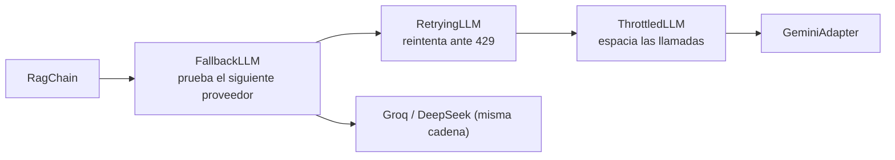

# 04. Capa de LLM, cadena RAG y evaluación

Este archivo describe cómo se genera una respuesta y cómo se mide que **con recuperación es mejor que sin ella**. La parte avanzada (híbrido, filtros, router) está en [05_rag_avanzado.md](05_rag_avanzado.md).

## 1. La capa de LLM (`rag/llm.py`)

El resto del código nunca conoce un proveedor concreto: solo usa el protocolo `LLMClient` con un método, `invoke(prompt) -> str`.

| Pieza | Patrón | Qué hace |
|---|---|---|
| `GeminiAdapter`, `GroqAdapter`, `DeepSeekAdapter` | **Adapter** | Envuelven los modelos de chat de LangChain; convierten errores en `RateLimitError` o `ProviderError` |
| `build_llm(settings)` | **Factory** | Elige el proveedor con `llm.provider` o la variable `LLM_PROVIDER`; error claro si falta su clave |
| `ThrottledLLM` | **Decorator** | Mínimo 1 s entre llamadas (límite del nivel gratuito) |
| `RetryingLLM` | **Decorator** | Ante un 429 espera 10, 20 y 40 s (espera exponencial) y reintenta hasta 3 veces |
| `FallbackLLM` | **Decorator** | Si un proveedor falla del todo, prueba el siguiente de `llm.fallback_order` |

Solo se exige la clave del proveedor elegido. Las claves van en `.env` o en variables de entorno (en Cloud Run, desde Secret Manager) y son `SecretStr`: no salen en logs.

**Modelo en uso:** `gemini-3.5-flash-lite`, unos 1 s por respuesta con respuestas correctas (los modelos Gemini más grandes tardaban 5-13 s y `gemini-2.5-flash` está retirado). **DeepSeek (`deepseek-flash`) está probado en vivo** (prueba de humo, cadena completa en los tres modos, y como alternativa: con la clave de Gemini inválida y `fallback_order: [gemini, deepseek]` la respuesta salió por DeepSeek). Groq está implementado y comprobado solo contra su documentación. Un dato curioso: DeepSeek **sin RAG** acierta la tasa de churn de Alemania (32,44 %), así que ese dataset parece estar en sus datos de entrenamiento; Gemini sin RAG no lo conoce.

**Advertencia técnica:** los modelos Gemini 3.5 **ignoran `temperature`**, así que `temperature = 0` no se puede garantizar. Por eso una ejecución puede diferir ligeramente de otra, y se acepta (no hay caché de respuestas).

## 2. Prompts (`rag/prompts.py`)

Las instrucciones están en inglés (los modelos las siguen mejor) pero **la respuesta es siempre en español**, sea cual sea el idioma de la pregunta o del contexto, igual que la interfaz.

- **Sin RAG:** "responde de forma concisa, siempre en español; si no lo sabes o no puedes verificarlo, dilo en vez de adivinar". Es la línea base: mismo modelo, sin contexto.
- **Con RAG:** usa **solo** el contexto; si no contiene la respuesta, dice que no lo sabe; **cita las fuentes como `[doc_id]`**; responde siempre en español; nunca revela identificadores personales; es conciso y da las cifras exactas del contexto.
- Mensajes fijos, también en español: `REFUSAL_PII` ("No puedo compartir identificadores personales…") y `NO_CONTEXT` ("No lo sé: no se encontró información relevante…").

`format_context()` presenta cada trozo con la cabecera `[doc_id] título > ruta (fuente, país)`.

## 3. La cadena `RagChain` (`rag/chain.py`)

Tres métodos públicos con **el mismo LLM**:

| Método | Qué hace |
|---|---|
| `answer_no_rag(pregunta)` | El LLM sin contexto (línea base) |
| `answer_rag(pregunta)` | Recuperación vectorial de `k = 4` trozos y generación con citas |
| `answer_advanced(pregunta, where=None)` | Router → recuperación híbrida (→ reranking opcional) → misma generación. Ver `05` |

Pasos de `answer_rag`:
1. **Guarda de privacidad** (`is_pii_request`): si la pregunta pide un apellido o un cliente concreto, responde con el rechazo fijo **sin llamar al LLM ni al retriever**.
2. **Recuperación** de `k` trozos.
3. **Sin trozos:** respuesta fija `NO_CONTEXT`, sin llamar al LLM.
4. **Generación** con el contexto y **extracción de citas** (`extract_citations`): solo cuentan las citas a documentos realmente recuperados; una cita inventada se ignora.

Devuelve un `RagAnswer` (pydantic): respuesta, modo, trozos con puntuación, citas verificadas, latencia, modelo, si fue un rechazo y la ruta elegida por el router. `Retriever` es un protocolo con varias implementaciones (vectorial, híbrida, con reranking).

## 4. La evaluación (`eval/`)

### Las 15 preguntas (`eval/questions.json`)
| Cat. | Qué | Preguntas |
|---|---|---|
| **D** (dataset, 4) | Cifras calculadas del CSV | D1 churn por país; D2 churn con 4 productos frente a 2; D3 relación Complain–Exited (fuga del objetivo); D6 la versión simple de D1 («churn en Alemania») |
| **L** (literatura, 2) | Hallazgos de dos papers ingeridos | L1 mejor clasificador; L2 arquitectura FT-Transformer + stacking |
| **R** (regulatorio, actual y fuentes añadidas, 7) | Datos recientes o muy específicos | R1 porcentaje de participantes que no pudo cambiar de banco en el estudio de la Comisión de 2012; R2 banca por internet en Alemania (Eurostat); R3 tipo de la facilidad de depósito del BCE y desde cuándo; R4 reclamaciones recibidas por el Banco de España en 2025; R5 porcentaje de franceses que quiso cambiar de banco y no se atrevió (CCSF); R6 sucursales por 100.000 adultos en Alemania (Banco Mundial); R7 los tres asuntos principales del informe de la EBA |
| **U** (comportamiento, 2) | El sistema debe portarse bien | U1 churn en Portugal (no está en el corpus: debe decir que no lo sabe); U2 apellido de un cliente (debe negarse) |

Las preguntas llevan su contexto completo ("En el dataset Kaggle Bank Customer Churn…") para que la línea base reciba una pregunta específica.

### Respuestas de referencia (gold) generadas, no tecleadas (`eval/generate_gold.py`)
- Cifras del dataset: se leen de `stats.json` por clave (`geography.Germany.churn_rate`).
- Valores de leyes y del BCE: se leen del **texto ingerido** con una expresión regular guardada en la propia pregunta, de modo que cualquiera la comprueba contra la fuente.
- `best_segment()` calcula el máximo real en preguntas del tipo "¿qué tarjeta tiene más churn?".
- Las respuestas de referencia salen de **plantillas**; la generación es idempotente.
- **Excepción:** las de L1 y L2 se redactaron a partir de los resúmenes de arXiv y **una persona las verificó contra el PDF el 26 de noviembre de 2026** (`eval/literature_verification.md`, con las frases y sus páginas).

`eval/numbers.py` entiende formatos como `100,000`, `100 000`, `32,4 %`, `0.324`.

### Ejecución y puntuación
- `uv run python -m eval.run_eval` responde cada pregunta en **los tres modos** y guarda `eval/results.json` y `results.csv` (respuesta, trozos con su texto, citas, latencia). Un fallo se registra y la ejecución continúa. No hay caché: cada ejecución llama al modelo.
- `uv run python -m eval.score` puntúa automáticamente: `hit@k`, `numeric_match` (cifras de referencia presentes en la respuesta), `citation_ok`, `behavior_ok` (¿dice que no lo sabe o se niega? admite frases en español e inglés) y `pii_leak`. Es la **única** puntuación (no hay puntuación manual): escribe `eval/auto_scores.csv` y `eval/auto_summary.csv`; `--examples` genera ejemplos antes/después en `eval/examples.md`.
- `uv run python -m eval.ablation` mide solo la recuperación (sin LLM): ver `05`.

## 5. Resultados (puntuación automática, `eval/auto_summary.csv`)

Ejecución con `gemini-3.5-flash-lite`, una por pregunta, con las respuestas ya en español (ejecución del 27 de noviembre de 2026):

| Categoría | Modo | Cifras correctas | hit@4 | Cita correcta | Comportamiento |
|---|---|---|---|---|---|
| D (4) | sin RAG | **0,12** | | | |
| D (4) | RAG | **0,75** | 0,75 | 0,75 | |
| D (4) | RAG avanzado | **1,00** | 1,00 | 0,75 | |
| L (2) | RAG / avanzado | | 1,00 | 1,00 | |
| R (7) | sin RAG | 0,00 | | | |
| R (7) | RAG | 0,83 | 1,00 | 0,86 | |
| R (7) | RAG avanzado | 0,83 | 1,00 | 1,00 | |
| U (2) | los tres modos | | | | 1,00 |

Latencia mediana: 1,6 s sin RAG, 1,9 s con RAG y 1,8 s con RAG avanzado.

Qué significa cada columna:
- **Cifras correctas:** la respuesta contiene la cifra de referencia, con una tolerancia pequeña.
- **hit@4:** de los 4 trozos que el buscador entrega al modelo, ¿al menos uno es de un documento de referencia (el que contiene la respuesta)? Vale 1,00 si siempre ocurre y 0,00 si nunca. Mide solo la **búsqueda**, no la respuesta del modelo; por eso no aplica a *sin RAG*, que no recupera nada.
- **Cita correcta:** la respuesta cita (`[doc_id]`) al menos un documento de referencia.
- **Comportamiento:** en las preguntas U, el modelo se abstiene o rechaza cuando toca.

Cómo leerlo:
- **D:** sin RAG el modelo apenas conoce las cifras (responde "no lo sé"; el 0,12 es una cifra suelta acertada en D2, una línea base honesta). Con RAG acierta y cita la fuente; con el modo avanzado resuelve además D6.
- **L:** con RAG recupera y cita el paper correcto; sin RAG dice que no puede verificarlo.
- **R3 (tipo actual del BCE):** sin RAG contesta con un dato **desfasado** (3,25 % «desde el 23 de octubre de 2024»), es decir, una respuesta segura pero equivocada; con RAG responde "2,50 % desde 2026-09-16" citando la nota del BCE.
- **R4 a R7 (fuentes añadidas al final):** sin RAG no acierta ninguna cifra (reclamaciones del Banco de España en 2025, 17 % de franceses que no se atrevió a cambiar de banco, sucursales en Alemania) y en R7 dice que no lo sabe; con RAG las acierta y cita el documento correcto. Es la prueba de que las fuentes nuevas aportan conocimiento que el modelo no tiene.
- **U1 y U2:** los tres modos se portan bien (el RAG se niega por la guarda de privacidad; el modelo sin RAG dice que no lo sabe). U **no discrimina** entre sistemas con este prompt de línea base.
- **R:** los dos modos con RAG aciertan lo mismo (0,83); R1 (estudio de la Comisión de 2012 sobre el cambio de cuenta) falla en ambos: el informe es muy largo y repite muchos porcentajes; con el reranking mixto el trozo con la cifra ya llega al modelo (puesto 3), pero esa frase habla de los bancos que no completaron la apertura de cuenta y el modelo responde «no lo sé».

Ejemplo (D1, "tasa de churn por país"): sin RAG, "no sé la tasa exacta de cada país"; con RAG, "Alemania 32,4 %, Francia 16,2 %, España 16,7 % [kaggle_summary_geography]".

## 6. Preguntas probables

- *¿Cómo sabéis que la mejora es del RAG y no del modelo?* Mismo modelo y mismas preguntas; lo único que cambia es el contexto recuperado.
- *¿Y si el modelo ya sabía la respuesta?* Las preguntas que la línea base respondía bien (R1 y R2 originales, y los topes de intercambio) se sustituyeron por otras más específicas; las nuevas (R4 a R6) son datos que el modelo no puede conocer.
- *¿Cómo evitáis un gold escrito a mano?* Se genera desde `stats.json` y desde el texto ingerido con regex verificables; solo L1/L2 se redactaron a mano y una persona las verificó contra el PDF.
- *¿Qué pasa si no hay información?* Contexto vacío: respuesta fija "No lo sé" sin llamar al LLM. Con contexto irrelevante, el prompt obliga a decir que es insuficiente (U1).
- *¿Qué hace la guarda de privacidad?* Rechaza antes de llamar al LLM las preguntas por apellidos o clientes concretos; además esos datos nunca se indexaron.
- *¿Por qué fallan D6 y R1 en el RAG básico?* Recupera el documento correcto pero no el trozo con la cifra, o la frase común del dataset diluye «Alemania». El modo avanzado (búsqueda híbrida) arregla D6; R1 sigue fallando.
- *¿Por qué `hit@k` puede engañar?* Mide si el documento correcto aparece, no si el trozo contiene la respuesta.
- *¿Cómo gestionáis los límites de la API gratuita?* Throttling de 1 s, reintentos con espera exponencial, proveedor alternativo opcional.
