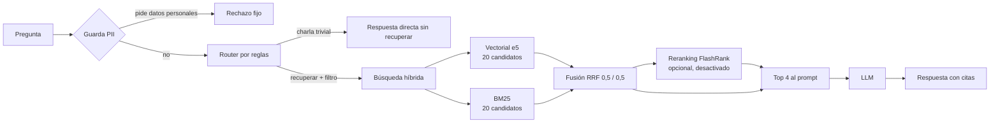

# 05. RAG avanzado: híbrido, filtros, router y reranking

El modo **RAG avanzado** (`RagChain.answer_advanced`) añade tres técnicas a la recuperación y usa **el mismo prompt y el mismo LLM** que el RAG básico, así que cualquier diferencia viene solo de qué trozos le llegan al modelo.

## 1. Búsqueda híbrida (BM25 + vectorial)

- **Por qué:** la búsqueda vectorial entiende el significado pero diluye términos exactos (un número de artículo, el nombre de un país en una frase larga); BM25 acierta con las palabras literales pero no entiende sinónimos. Combinarlas cubre los dos fallos.
- `rag/lexical.py`: índice BM25 (`rank_bm25`) sobre *título + ruta de encabezados + texto* de cada trozo. `matches_where` aplica a BM25 los mismos filtros de metadatos que Chroma aplica a la parte vectorial.
- `rag/retrievers.py`, `HybridRetriever`: pide **20 candidatos a cada lado** y los fusiona con **Reciprocal Rank Fusion** ponderada (0,5 / 0,5, `rrf_k = 60`): cada documento suma `peso / (rrf_k + posición)` en cada lista. RRF solo usa posiciones, así que no hace falta normalizar puntuaciones de escalas distintas.
- Todo sale de `config.yaml` → `retrieval` (`candidates`, `vector_weight`, `bm25_weight`, `rrf_k`).

## 2. Filtros por metadatos y router

- Cada trozo lleva los metadatos del documento (tipo de fuente, geografía, idioma, tema, columnas del dataset, licencia). Chroma los filtra de forma nativa; es una de las razones de elegirlo.
- `rag/router.py` (`RuleRouter`) decide con **reglas deterministas** (palabras clave en inglés, español, francés y alemán):
  - **Charla trivial** ("hola", "gracias", "¿qué puedes hacer?"): no recupera, responde directamente.
  - **Tipo de fuente:** "kaggle" o "dataset" → `dataset_stats`; "paper", "arxiv" → `paper`; "reglamento", "article 3", "GDPR" → `regulation` y `regulator_guide`; "Eurostat", "BCE", "inflación" → `macro_data` y `press`.
  - **País:** si la pregunta nombra un único país, filtra por `geography ∈ {país, EU}` en los tipos que son por país.
- **El filtro es una pista:** si no devuelve nada, la búsqueda se repite sin filtro. Los filtros elegidos a mano en la interfaz **tienen prioridad** sobre el router.
- **Por qué reglas y no un LLM:** son gratis, instantáneas, deterministas y se prueban con tests unitarios. Limitación: solo conocen las palabras clave previstas.

## 3. Reranking (implementado, medido y desactivado)

`RerankingRetriever` (decorador sobre cualquier retriever) reordena los candidatos con un *cross-encoder* local (`rag/rerank.py`, **FlashRank**, ONNX, sin clave ni coste). Se activa con `retrieval.rerank_enabled`. Está **desactivado por defecto** porque en nuestras 12 preguntas no mejoró la recuperación híbrida y los modelos más grandes la empeoraron (tabla siguiente). FlashRank descarga su modelo la primera vez, por eso la imagen de Docker no lo incluye.

## 4. Ablación (solo recuperación, 12 preguntas con fuentes de referencia, a nivel de trozo)

`uv run python -m eval.ablation` → `eval/ablation.csv` y `eval/ablation_detail.csv`. `hit@4` es lo que ve el LLM.

| Configuración | hit@1 | hit@4 | MRR |
|---|---|---|---|
| Vectorial (base) | 0,667 | 0,917 | 0,794 |
| **+ híbrida (BM25 + vectorial)** | **0,833** | **1,000** | **0,903** |
| + reranking (TinyBERT) | 0,833 | 1,000 | 0,896 |
| + filtros (router, híbrida) | 0,833 | 1,000 | 0,903 |
| + filtros + reranking (TinyBERT) | 0,833 | 1,000 | 0,896 |
| Reranking MiniLM-L-12 (+ filtros) | 0,667 | 1,000 | 0,812 |
| Reranking MultiBERT-L-12 (+ filtros) | 0,417 | 0,500 | 0,454 |

Lectura:
- **La técnica que rinde es la búsqueda híbrida.** Arregla D6 («churn en Alemania»): la ficha de Alemania pasa del puesto 5 al 1 y la respuesta de incorrecta a correcta.
- Los **filtros** no añaden nada medible sobre la híbrida con estas preguntas (ya acierta); su valor es de control para el usuario y de reducción de ruido.
- El **reranking** no ayuda aquí y los cross-encoders grandes empeoran: están entrenados con páginas web y hunden las fichas de estadísticas; el multilingüe es mucho peor.
- Con 12 preguntas una vale 0,083: las diferencias pequeñas son ruido.

## 5. A nivel de respuesta (`eval/auto_summary.csv`)

Cifras correctas: D **0,00 / 0,83 / 1,00** y R **0,25 / 0,75 / 0,62** (sin RAG / RAG / RAG avanzado). Citas correctas: D 0,50 frente a 0,83 y R 0,50 frente a 1,00 (RAG frente a avanzado). R1 sigue imperfecta (su cifra está en el trozo vecino) y R4 varía entre ejecuciones.

## 6. Preguntas probables

- *¿Por qué híbrida y no solo vectorial?* Porque los términos exactos y los números se pierden en el espacio semántico; medimos que sube hit@1 de 0,667 a 0,833 y MRR de 0,794 a 0,903.
- *¿Qué es RRF y por qué no sumar las puntuaciones?* Fusiona **posiciones**, no puntuaciones; BM25 y coseno están en escalas incomparables.
- *¿Por qué dejáis el reranking desactivado si lo implementasteis?* Porque lo medimos y no mejora (y los grandes empeoran); activar una configuración peor para la demo no tendría sentido. Se puede activar con una línea de configuración.
- *¿Por qué un router por reglas?* Determinista, gratuito y comprobable; un LLM añadiría latencia, coste y variabilidad por una decisión que las palabras clave resuelven.
- *¿Qué pasa si el filtro del router se equivoca?* Es una pista: si no hay resultados se repite sin filtro; y el usuario puede imponer los suyos.
- *¿Qué no hicisteis?* Chunking semántico, router basado en LLM y trozos vecinos (R1 los necesitaría).
