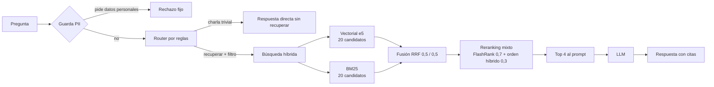

# 05. RAG avanzado: híbrido, filtros, router y reranking

El modo **RAG avanzado** (`RagChain.answer_advanced`) añade tres técnicas a la recuperación y usa **el mismo prompt y el mismo LLM** que el RAG básico, así que cualquier diferencia viene solo de qué trozos le llegan al modelo.

## 1. Búsqueda híbrida (BM25 + vectorial)

- **Por qué:** la búsqueda vectorial entiende el significado pero diluye términos exactos (un número de artículo, el nombre de un país en una frase larga); BM25 acierta con las palabras literales pero no entiende sinónimos. Combinarlas cubre los dos fallos.
- `rag/lexical.py`: índice BM25 (`rank_bm25`) sobre *título + ruta de encabezados + texto* de cada trozo. `matches_where` aplica a BM25 los mismos filtros de metadatos que Chroma aplica a la parte vectorial.
- `rag/retrievers.py`, `HybridRetriever`: pide **20 candidatos a cada lado** y los fusiona con **Reciprocal Rank Fusion** ponderada (0,5 / 0,5, `rrf_k = 60`): cada documento suma `peso / (rrf_k + posición)` en cada lista. RRF solo usa posiciones, así que no hace falta normalizar puntuaciones de escalas distintas.
- Todo sale de `config.yaml` → `retrieval` (`candidates`, `vector_weight`, `bm25_weight`, `rrf_k`).

## 2. Filtros por metadatos y router

- Cada trozo lleva los metadatos del documento (tipo de fuente, geografía, idioma, tema, columnas del dataset, licencia). Chroma los filtra de forma nativa; es una de las razones de elegirlo.
- `rag/router.py` (`RuleRouter`) decide con **reglas deterministas** (palabras clave en inglés, español, francés y alemán):
  - **Charla trivial** ("hola", "gracias", "¿qué puedes hacer?"): no recupera, responde directamente.
  - **Tipo de fuente:** "kaggle" o "dataset" → `dataset_stats`; "paper", "arxiv" → `paper`; "reglamento", "article 3", "GDPR" → `regulation` y `regulator_guide`; "Eurostat", "BCE", "inflación" → `macro_data` y `press`.
  - **País:** si la pregunta nombra un único país, filtra por `geography ∈ {país, EU}` en los tipos que son por país.
- **El filtro es una pista:** si no devuelve nada, la búsqueda se repite sin filtro. Los filtros elegidos a mano en la interfaz **tienen prioridad** sobre el router.
- **Por qué reglas y no un LLM:** son gratis, instantáneas, deterministas y se prueban con tests unitarios. Limitación: solo conocen las palabras clave previstas.

## 3. Reranking mixto (activado)

`RerankingRetriever` (decorador sobre cualquier retriever) reordena los 20 candidatos con un *cross-encoder* local (`rag/rerank.py`, **FlashRank** TinyBERT, ONNX, sin clave ni coste) y `BlendedReranker` **mezcla** ese orden con el de la búsqueda híbrida: `peso / (60 + posición del cross-encoder) + (1 - peso) / (60 + posición híbrida)`, con `peso = 0,7`. Usado solo, el *cross-encoder* empeoraba una híbrida que ya era muy buena; la mezcla conserva su ventaja y evita su pérdida. Se activa con `retrieval.rerank_enabled` y se ajusta con `rerank_weight` y `rerank_with_title` (si el *cross-encoder* ve el título del documento y la ruta de encabezados). La imagen de Docker descarga el modelo de FlashRank al construirse, no en el arranque.

## 4. Ablación (solo recuperación, 13 preguntas con fuentes de referencia, a nivel de trozo)

`uv run python -m eval.ablation` → `eval/ablation.csv` y `eval/ablation_detail.csv`. `hit@4` es lo que ve el LLM. Hay dos medidas: **por documento** (hit@k, MRR: algún trozo de un documento de referencia) y **por trozo** (fact@k, fact MRR, sobre las 10 preguntas con cifra: el trozo debe ser de un documento de referencia **y contener la cifra**).

| Configuración | hit@1 | hit@4 | MRR | fact@1 | fact@4 | fact MRR |
|---|---|---|---|---|---|---|
| Vectorial (base) | 0,846 | 0,923 | 0,887 | 0,70 | 0,90 | 0,778 |
| **+ híbrida (BM25 + vectorial)** | **1,000** | 1,000 | **1,000** | 0,90 | 0,90 | 0,900 |
| + reranking (TinyBERT, solo) | 0,923 | 1,000 | 0,962 | 0,80 | 1,00 | 0,883 |
| **+ reranking mixto (TinyBERT, 0,7)** | **1,000** | 1,000 | **1,000** | 0,90 | **1,00** | **0,933** |
| + filtros (router, híbrida) | 1,000 | 1,000 | 1,000 | 0,90 | 0,90 | 0,900 |
| + filtros + reranking (TinyBERT, solo) | 0,923 | 1,000 | 0,962 | 0,80 | 1,00 | 0,883 |
| + filtros + reranking mixto (TinyBERT, 0,7) | 1,000 | 1,000 | 1,000 | 0,90 | 1,00 | 0,933 |
| Reranking MiniLM-L-12 (+ filtros) | 0,769 | 1,000 | 0,865 | 0,60 | 1,00 | 0,775 |
| Reranking MultiBERT-L-12 (+ filtros) | 0,462 | 0,692 | 0,545 | 0,20 | 0,50 | 0,308 |

Lectura:
- **La técnica que rinde es la búsqueda híbrida.** Arregla D6 («churn en Alemania»): la respuesta pasa de incorrecta a correcta y el hit@1 sube de 0,846 a 1,000.
- Los **filtros** no añaden nada medible sobre la híbrida con estas preguntas (ya acierta); su valor es de control para el usuario y de reducción de ruido.
- **Por documento** la híbrida ya es perfecta, así que un reranking no puede mejorar; **por trozo** sí: la híbrida no trae el trozo con la cifra en **R1** (fact@4 0,90) y el reranking lo sube al puesto 3.
- El *cross-encoder* **solo** cuesta precisión (D6 baja del puesto 1 al 2; hit@1 0,923) y los grandes empeoran más: están entrenados con páginas web y hunden las fichas de estadísticas; el multilingüe es mucho peor.
- La **mezcla** conserva la mejora de R1 y los aciertos en primer puesto (hit@1 1,000, fact MRR 0,933).
- `eval/rerank_sweep.csv` (`uv run python -m eval.rerank_sweep`) prueba 27 variantes (candidatos 10/20/30, peso 1,0/0,7/0,5/0,3, con o sin título): pesos de 0,5 a 0,7 con título dan lo mismo con cualquier tamaño, así que 0,7 con 20 candidatos no es un ajuste frágil; sin título o con peso 0,3 la mejora es menos estable.
- Con 13 preguntas (10 con cifra) una vale 0,077 (0,1) y la mezcla se eligió con esas mismas preguntas: es evidencia a favor, no una garantía.

## 5. A nivel de respuesta (`eval/auto_summary.csv`)

Cifras correctas: D **0,12 / 0,75 / 1,00** y R **0,00 / 0,83 / 0,83** (sin RAG / RAG / RAG avanzado). Citas correctas: D 0,75 y 0,75 y R 0,86 y 1,00 (RAG frente a avanzado). R1 sigue fallando en los dos modos: con el reranking su cifra ya llega al modelo (puesto 3), pero la frase habla de los bancos que no completaron la apertura de cuenta y el modelo responde «no lo sé». Al añadir las fuentes nuevas apareció un fallo del router: la palabra «study» activaba el filtro de papers de arXiv y ocultaba el estudio del Bundesbank; ahora solo lo activan «arXiv», «paper», «authors» y «transformer».

## 6. Preguntas probables

- *¿Por qué híbrida y no solo vectorial?* Porque los términos exactos y los números se pierden en el espacio semántico; medimos que sube hit@1 de 0,846 a 1,000 y MRR de 0,887 a 1,000.
- *¿Qué es RRF y por qué no sumar las puntuaciones?* Fusiona **posiciones**, no puntuaciones; BM25 y coseno están en escalas incomparables.
- *¿Por qué el reranking es «mixto»?* Porque el *cross-encoder* solo empeoraba una híbrida muy buena (D6 bajaba al puesto 2). Mezclar su orden con el híbrido (peso 0,7) conserva la mejora de R1 y los aciertos en primer puesto; lo comprobamos con 27 variantes.
- *¿Y por qué no un reranker multilingüe mejor?* Los candidatos serios (p. ej. bge-reranker-v2-m3) pesan cientos de MB y harían crecer mucho la imagen; con la mezcla el modelo pequeño ya basta para estas preguntas.
- *¿Por qué un router por reglas?* Determinista, gratuito y comprobable; un LLM añadiría latencia, coste y variabilidad por una decisión que las palabras clave resuelven.
- *¿Qué pasa si el filtro del router se equivoca?* Es una pista: si no hay resultados se repite sin filtro; y el usuario puede imponer los suyos.
- *¿Qué no hicisteis?* Chunking semántico, router basado en LLM y trozos vecinos (R1 los necesitaría).
